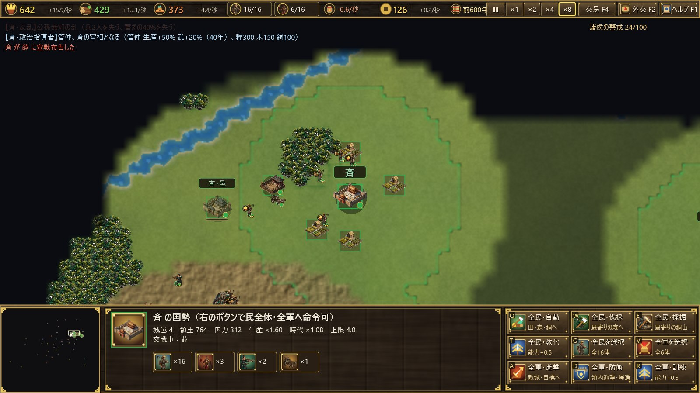

# 春秋戦国 — 中華統一への道

Rust + Direct3D11 / Direct2D / DirectWrite で作った、Age of Empires 風のリアルタイムストラテジーです。
UI フレームワークやゲームエンジンは使わず、`windows` クレート（Win32 API バインディング）だけで描画・入力・UI を自作しています。

**ドキュメント**：紹介とユーザーガイド（[日本語](docs/ja/introduction.md)・[English](docs/en/introduction.md)・[中文](docs/zh/introduction.md)）。一覧は [docs/](docs/README.md)。



## 実行

```
cargo run --release
```

## ゲームの特徴

- **舞台**：紀元前770年〜前221年の中国。実在の春秋諸国 38 か国を史実のおおよその位置（経緯度）に配置。黄河（春秋期の古河道）・長江・渭水・淮水などの河川、太行・秦嶺などの山脈を再現した地図。
- **共通の時間軸**：時間はマップ全体で共有（春秋時代は1年＝4秒、戦国時代はゆっくり流れて1年＝8秒）。前453年に春秋時代から戦国時代へ移り、晋は韓・趙・魏に分裂する（三家分晋）。
- **文明格差なし**：時代補正・能力上限は全国共通。一部の国だけ文明が進むことはない。
- **七雄バイアス**：秦・楚・斉・燕・晋（→韓・趙・魏）は生産能力 ×1.6 で、生き残りやすい。
- **少数精鋭**：民・兵の数には上限（城邑数で増加）。その代わり一体ごとに「訓練／教化」で能力を高められる。
- **維持費**：軍事ユニットは存在するだけで糧を消費する。
- **兵⇔民の転換**：解散・徴兵ができるが、能力は 2/3 に目減りする。
- **建設の予約**：Ctrl を押しながら建物を置くと予約になり、民は今の建設を終えてから置いた順に建てていく。
- **要塞**：Age of Empires の塔のように、近づく敵兵を射る建物。余った資源の使い道で、数は「1＋城邑の数÷2」まで（最大6）。
- **訓練・教化の費用**：糧・木・銅のうち蓄えの多いものから優先して払うので、資源が偏って余ることがない。
- **覇者の呼びかけ（春秋）**：攻撃を繰り返して諸侯の警戒が 100 に達すると、最強国の呼びかけで周辺国が 15 年間一斉に攻めてくる。
- **合従軍（戦国）**：突出した最強国に対し、周辺国が合従して 15 年間一斉に攻撃する。
- **戦場の霧**：自国の民・兵・建物の周囲だけが見える。探索済みの土地は暗く残り、敵兵は視界内でしか見えない（諸侯の都の位置は最初から既知）。
- **英霊モード（オプション、既定は無効）**：タイトル画面で選ぶ。民を生贄に捧げて三皇五帝から春秋戦国の英霊31人を時代と国を超えて召喚できる（能力は生贄の合計の1.1〜3.0倍、一国一体、他国も召喚）。英霊だけが上帝の兵を傷つけられ、上帝降臨から10年後の版図が上帝の秦より広ければ勝利。
- **上帝降臨**：史実で中華が統一された前221年までに天下を統一できないと、上帝が秦に降臨する（秦が滅んでいても蘇る）。上帝の軍は傷つかず和睦もできず、10年で中華を統一し、強制的にゲームオーバーとなる。
- **国の特徴**：国ごとに史実に基づく特徴を持つ。周は春秋時代には滅びない（天子の王畿）、秦は関中の険（城が堅い）と軍功爵制（前356年〜）、晋は戦車の大国、趙は胡服騎射（前307年〜）、韓は強弓勁弩、魏は魏武卒、斉は魚塩の利、宋・鄭は商人の国、魯は周礼、呉は名剣、越は臥薪嘗胆、蜀は天府の国、北方の諸族は騎馬の民など。
- **広い地図**：経緯度あたりのタイル数を旧来の2倍（面積4倍、560×480）にし、国と国の間に余裕を持たせた。
- **指揮中は時が止まる**：自国の部隊を選んでから命令を出すまで（範囲選択のドラッグ中も）時間が止まる。
- **交易（F4）**：国に属さない商人が諸国を巡り、生産力の高い国に集まる。領内を通る商人から税（銭）が入り、商人の数は中原全体の生産量に比例して増える。銭で糧・木・銅を買える。税率（軽・中・重）で商人の集まりやすさが変わる。
- **西域の商人**：河西回廊（関中・河東・洛邑・鄭）、草原の道（晋陽・代・中山・燕）、蜀身毒道（蜀・巴、前400年ごろから）の先の地域にだけ来る。斉・魯・宋や江南には来ない。西域は国としては扱わない。
- **山岳民・遊牧民**：犬戎・山戎・群蛮百濮・百越・陸渾の戎・西戎・林胡・東胡・西南夷・月氏・匈奴が史実の年代にだけ現れる。国としては扱わず、守りの薄い国への略奪（城邑を落とすと蓄えを奪って引き上げる）か交易に来る。銭で傭兵として雇え、雇った部族はその間その国を襲わない。
- **秦と蜀の古道**：褒斜道・故道（秦嶺越え）と金牛道（剣閣越え）で関中から漢中・蜀へ行ける。蜀から滇へは蜀身毒道。
- **史実の出来事**：管仲・孔子・孫武・商鞅・楽毅・白起など、英雄・諸子百家・政治指導者が史実の年に現れて、その国の生産や武を一定年数高める。曲沃代翼・田氏代斉・子之の乱などの反乱・簒奪では兵や蓄えを失い、君主家（国姓）が変わる。合従・連衡・弭兵の会のように外交が動く出来事もある。その国が既に滅んでいれば起こらない（全83件、記録はゲーム内の「史記」F3）。

初めて遊ぶときは、タイトル画面の「チュートリアル」で操作と遊び方を1段ずつ学べます（晋で開始、22段、達成すると自動で次へ進む）。

操作はゲーム内の F1（ヘルプ）を参照。文字が小さいときは Ctrl＋＋／Ctrl＋−（またはタイトル画面の「A−／A＋」）で拡大縮小、F11 で全画面。画面の解像度に合わせて UI は自動で拡大される。

**表示言語**：日本語・英語・中国語（簡体字）。タイトル画面の言語ボタン（「日本語 ▸」など）で切り替え、選んだ言語は %APPDATA%\yyempire\settings.txt に保存される。初回は Windows の表示言語に合わせる（日本語・中国語以外は英語）。

## 記録（セーブ・ロード）

F5（または画面右上の「記録 F5」）で記録画面を開く。3枠の手動記録と、10年ごとの自動記録がある。タイトル画面の「続きから」で再開できる。
記録は `%APPDATA%\yyempire\saves\slot{N}.yysav`（見出しと保存日時は `slot{N}.txt`）に保存する（約100KB〜数百KB）。一時ファイルに書いてから置き換えるので、書き込み中に落ちても前の記録は壊れない。
「書き出す」でファイル（.yysav）にし、「ファイルから読み込む」で再開できる。ブラウザ版（[ykwyuta/yyempire](https://github.com/ykwyuta/yyempire)）と同じ形式。
地図は乱数の種から作り直し、伐採・採掘による変化だけを記録する。形式の版（`SAVE_VERSION`）が違う記録は読み込まずに知らせる。

## 構成

| ファイル | 内容 |
|---|---|
| `src/main.rs` | Win32 ウィンドウとメッセージループ |
| `src/lang.rs` | 表示言語（日本語・英語・中国語）の切り替えと `t!`／`tf!` マクロ |
| `src/i18n.rs` | データ（国名・史実の出来事・特徴・英霊・部族・チュートリアル）の英語・中国語訳 |
| `build.rs` | アプリのアイコン（`assets/app_icon.ico`、256〜16px の5サイズ）を資源として exe に埋め込む |
| `src/gfx.rs` | Direct3D11（地形テクスチャ・図形バッチ）と Direct2D/DirectWrite（文字・UI） |
| `src/geo.rs` | 地理データ（海岸線・河川・山脈）、国家データ、地形生成 |
| `src/world.rs` | シミュレーション：ユニット、建物、経済、戦闘、外交、イベント |
| `src/world/history.rs` | 史実年表（人物・反乱・簒奪）と君主家、その効果 |
| `src/world/traits.rs` | 国ごとの史実に基づく特徴（周の不滅など） |
| `src/world/heroes.rs` | 英霊モード：英霊の一覧、生贄による召喚、AI の召喚 |
| `src/world/descent.rs` | 上帝降臨（秦の復活、上帝の軍、10年での統一と勝敗） |
| `src/game/heroes.rs` | 英霊召喚画面と英霊の名札 |
| `src/world/trade.rs` | 交易：商人・西域の商人・山岳民と遊牧民（略奪・交易・傭兵） |
| `src/ai.rs` | コンピュータ国家の思考 |
| `src/path.rs` | A* 経路探索 |
| `src/game.rs` | 画面、入力、HUD、外交・ヘルプ画面 |
| `src/game/tutorial.rs` | チュートリアル（段ごとの説明・強調表示・達成判定） |
| `src/game/chronicle.rs` | 史記画面（出来事の記録、各国の君主家と人物） |
| `src/game/market.rs` | 交易画面（税率・市場・西域の道・部族と傭兵）と隊商の描画 |
| `src/game/save.rs`・`src/world/save.rs`・`src/save.rs` | 記録の画面・自動記録、World の読み書き、外部クレートなしのバイナリ形式 |
| `src/platform.rs` | 記録ファイルの置き場所（%APPDATA%）とファイルダイアログ |

## CI

GitHub Actions（`.github/workflows/build.yml`）が push・プルリクエストのたびに Windows でリリースビルドとテストを行い、`yyempire.exe` を成果物（yyempire-windows）として保存する。Actions 画面の「Run workflow」から手動でも実行できる。

## テスト

全国 AI で 549 年間をヘッドレスで回すシミュレーション：

```
cargo test --release long_sim -- --nocapture
```

`SIM_SEED`、`SIM_YEARS` 環境変数でシードと年数を指定できます。
