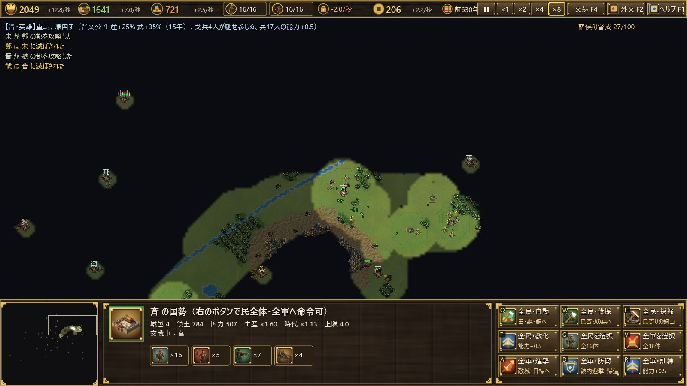

# Spring and Autumn, Warring States — The Road to Unification

English ｜ [中文](../zh/introduction.md) ｜ [日本語](../ja/introduction.md)

**770 BC. The Zhou court flees east.** The Son of Heaven's authority is fading, and dozens of feudal lords rise to claim their share of the realm. In the Spring and Autumn period, hegemons preside over the covenants of the lords. In the Warring States period, seven great powers fight for survival. You take the throne of one state, and you must unite all under Heaven by 221 BC.

*Spring and Autumn, Warring States — The Road to Unification* (春秋戦国 — 中華統一への道) is a real-time strategy game set across 550 years of ancient Chinese history. It runs on Windows and is built from scratch with Rust, Direct3D 11 and Direct2D.

> The in-game text is currently in Japanese. This guide explains every screen in English.

## Features

### A historical map with 41 states
The old course of the Yellow River, the Yangtze, the Wei and the Huai flow across the map, between the Taihang, Qinling and Daba mountains. The map follows real longitude and latitude. Forty-one states stand where history placed them: Zhou, Jin, Qin, Chu, Qi and Yan, but also Lu, Song, Zheng and Wei, Wu and Yue, Ba and Shu, and the Di and Rong peoples of the north and west. The Baoxie and Jinniu roads cross the mountains between Qin and Shu.

### Every state has its own history
Each state has traits drawn from history.

- **Zhou** is the seat of the Son of Heaven, and it cannot fall during the Spring and Autumn period, however weak it becomes.
- **Qin** is guarded by the passes of Guanzhong, so its walls are hard to break. After Shang Yang's reforms its soldiers are cheap to raise.
- **Zhao** adopts nomad dress and mounted archery (from 307 BC), **Han** makes the finest crossbows, and **Wei** fields the elite Wei Wuzu infantry.
- **Qi, Song and Zheng** draw merchants and grow rich.

### 83 historical events
Heroes, philosophers of the Hundred Schools and statesmen appear in their historical year: Guan Zhong, Confucius, Sun Tzu, Shang Yang, Yue Yi, Bai Qi and more. Revolts and usurpations change ruling houses, such as Quwo taking Jin, the Tian clan taking Qi, and the Zizhi affair in Yan. In 453 BC Jin splits into Han, Zhao and Wei, and the Warring States period begins. An event never happens if its state has already been destroyed.

### Trade, and peoples outside the states
- **Merchants**: merchants who serve no state travel between cities. They gather in the most productive states and pay you tax in coin.
- **Western merchants**: merchants from the Western Regions arrive along the Hexi Corridor, the Steppe Road and the Shu–India road.
- **Mountain and steppe peoples**: the Quanrong, Shanrong, Linhu, Donghu, Xiongnu, Baiyue and others appear in their own eras. They come to raid, or to sell horses. Pay them in coin and they will fight for you as mercenaries.

### A small elite army, and time that waits for you
- **Unit limits**: the number of workers and soldiers is capped. You make up for it by training each unit individually, and every soldier eats grain just by existing.
- **Counters**: halberdiers, chariots (cavalry) and crossbowmen beat one another in a circle.
- **Time stops while you command**: while you have your own units selected, time stands still.
- **Slower Warring States**: time flows more slowly once the Warring States period begins.

### Heroic Spirits mode (optional)
Turn on Heroic Spirits mode on the title screen and you can sacrifice workers to call heroes from the Three Sovereigns and Five Emperors to the Warring States, such as the Yellow Emperor, Yu the Great, Jiang Ziya, Sun Tzu and Bai Qi, regardless of era or state. Each state may have only one hero, and rival states summon them too. Only heroes can stand against the Deity's army.

### The Mandate's deadline
China was unified in 221 BC. If you have not unified it by then, the Supreme Deity descends upon Qin. Qin rises again even if it was destroyed, and no one can resist the Deity's army. History will not wait for you.

## How to play

- You need Windows 10 or 11 with a Direct3D 11 graphics card.
- See the [User Guide](user-guide.md). New players can start the **Tutorial** from the title screen. It teaches the controls one step at a time.
