# User Guide — Spring and Autumn, Warring States: The Road to Unification

English ｜ [中文](../zh/user-guide.md) ｜ [日本語](../ja/user-guide.md)

For an overview of the game, see the [Introduction](introduction.md).

> The game's on-screen text is in Japanese. This guide gives the Japanese label in brackets, such as Diplomacy (外交), so you can find each button on screen.

## Contents

1. [Installing and starting](#1-installing-and-starting)
2. [Goal of the game](#2-goal-of-the-game)
3. [Choosing a state](#3-choosing-a-state)
4. [The screen](#4-the-screen)
5. [Basic controls](#5-basic-controls)
6. [Economy: resources, workers, buildings](#6-economy-resources-workers-buildings)
7. [Military: units, training, upkeep](#7-military-units-training-upkeep)
8. [Time stops while you command](#8-time-stops-while-you-command)
9. [Diplomacy and coalitions](#9-diplomacy-and-coalitions)
10. [Eras and historical events](#10-eras-and-historical-events)
11. [Trade and coin](#11-trade-and-coin)
12. [Mountain and steppe peoples, and mercenaries](#12-mountain-and-steppe-peoples-and-mercenaries)
13. [Merchants from the Western Regions](#13-merchants-from-the-western-regions)
14. [State traits](#14-state-traits)
15. [The Descent of the Supreme Deity (time limit)](#15-the-descent-of-the-supreme-deity-time-limit)
16. [Heroic Spirits mode (optional)](#16-heroic-spirits-mode-optional)
17. [Keyboard reference](#17-keyboard-reference)
18. [Tips](#18-tips)

---

## 1. Installing and starting

**Requirements**: Windows 10 or 11, and a graphics card that supports Direct3D 11.

**Using a prebuilt exe**
1. Open **Actions** in the GitHub repository and choose a successful run of the "build" workflow.
2. Download **Artifacts → `yyempire-windows`** and unzip it.
3. Run `yyempire.exe`. All images are built into the exe, so this one file is all you need.

**Building from source** (requires Rust)

```
cargo run --release
```

If the text is too small, press **Ctrl + +** or **Ctrl + −** (or use 文字 ＋／− on the title screen). **F11** switches to full screen.

## 2. Goal of the game

The game starts in 770 BC. You win by **destroying every other state before 221 BC**.

- Time flows at the same speed for every state. In the Spring and Autumn period, 1 year = 4 seconds.
- In 453 BC the Warring States period begins, and time slows to 1 year = 8 seconds.
- If you lose all your cities, your state is destroyed and you lose.
- If you have not unified China by 221 BC, the [Descent of the Supreme Deity](#15-the-descent-of-the-supreme-deity-time-limit) begins and the game ends in defeat.

## 3. Choosing a state


Click a capital on the map to see that state in the right-hand panel.

- **Productivity (生産力)**: how much the state earns from city taxes and gathering. States with a gold mark are the Seven Warring States, with productivity ×1.6.
- **Starting cities and ruling house (初期城邑・君主家)**: the ruling house (clan) can change through revolts and usurpations.
- **Difficulty (難易度)**: the Seven are easy, small states are hard.
- **Traits (特徴)**: the state's historical traits. Hover over the line to read them (see [section 14](#14-state-traits)).

Click 「この国で覇業を開始」 to start. New players should choose 「はじめての方は：チュートリアル」 (Tutorial). You play as Jin, and 22 steps teach you the controls one at a time.

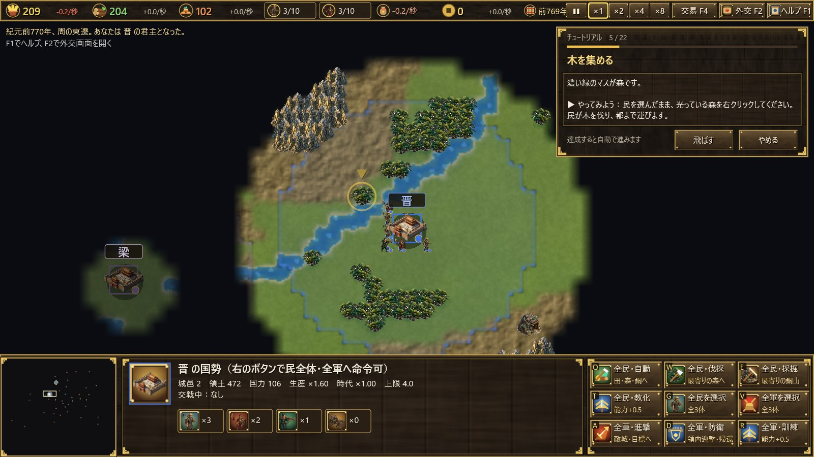

## 4. The screen

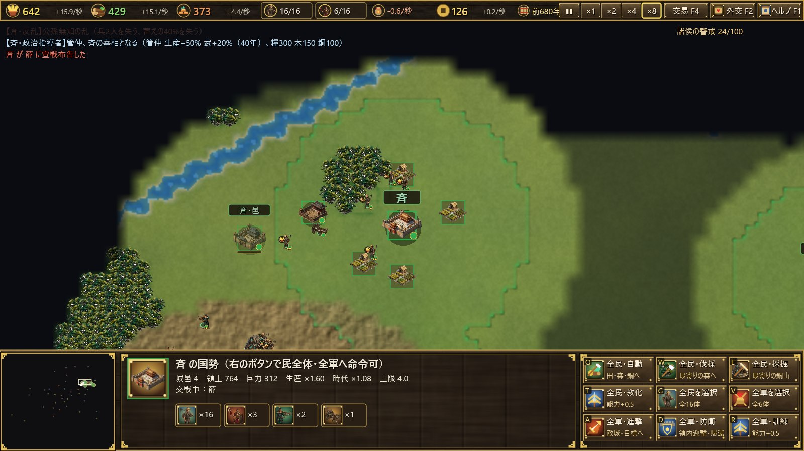

**Top bar (from the left)**

| Item | Meaning |
|---|---|
| Grain, wood, bronze (糧・木・銅) | Stock and change per second (grain shown after upkeep) |
| Workers n/limit (民) | Click to select all workers |
| Soldiers n/limit (兵) | Click to select the whole army |
| Upkeep | Grain your army eats per second |
| Coin (銭) | Tax from merchants. Click to open the Trade screen |
| Year | Year BC and era |
| Speed | Pause, ×1, ×2, ×4, ×8 |
| Trade F4 (交易) / Diplomacy F2 (外交) / Help F1 (ヘルプ) | Open each screen |

**Bottom panel**: the minimap is on the left (click to jump there). The middle shows the selected unit or building. The right holds command buttons; the letter in each button's corner is its hotkey.

**The map**
- Coloured lines mark each state's borders.
- **Fog of war**: you only see around your own workers, soldiers and buildings. Land you have seen stays dimmed: you still see its terrain and cities, but not enemy troops. The capitals of all states are known from the start.
- An ox cart with a small flag is a merchant, a camel is a merchant from the Western Regions, and a horse is a tribal caravan.

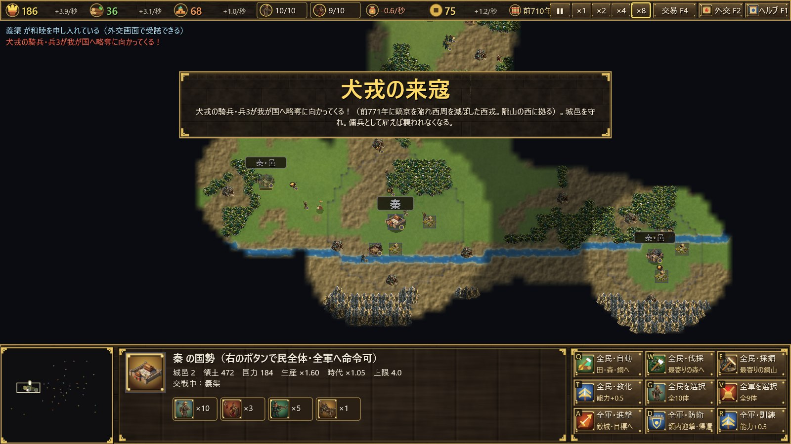

## 5. Basic controls

| Input | Action |
|---|---|
| Left click | Select a unit or building |
| Drag | Box select |
| Double click | Select all units of the same type |
| Shift + click | Add to the selection |
| Right click | Move, attack, gather (forest, mine, field), help build |
| Right click with a building selected | Set its rally point |
| Mouse wheel | Zoom |
| Middle drag, arrow keys, screen edge | Scroll |
| Home | Jump to your capital |
| Space | Pause |

Hover over any button to see a tooltip.

## 6. Economy: resources, workers, buildings

There are three **resources**.
- **Grain (糧)**: from farming fields. Used to train workers and soldiers, and to feed the army.
- **Wood (木)**: from cutting forests. Used for buildings, crossbows and chariots.
- **Bronze (銅)**: from mining. Used for soldiers and towns.

**Workers (民)** gather resources and carry them to the capital or a town. Each city also pays a small tax.

| Building | Cost (grain/wood/bronze) | Role |
|---|---|---|
| Capital (都) | — | Heart of the state; trains workers. If it falls, a town becomes the new capital |
| Town (邑) | 100 / 250 / 80 | Expands territory and raises worker and soldier limits; trains workers. Must be at least 9 tiles from any city and within 26 of one of yours |
| Barracks (兵営) | 0 / 150 / 30 | Trains soldiers |
| Field (田) | 0 / 60 / 0 | Produces grain when a worker farms it |

Buildings go inside your own territory. Select a worker, press Q, W or E in the command panel (field, barracks, town), then click where to build.

**Worker and soldier limits** are each 4 + 3 × your number of cities (25 at most). More towns mean a bigger state.

Handy commands:
- **Auto gather (F, 自動採集)**: spreads the selected workers over free fields, forests and mines.
- **All workers – auto / wood / bronze (全民・自動／伐採／採掘)**: orders every worker at once.
- **. (period)**: selects an idle worker.

## 7. Military: units, training, upkeep

| Unit | Cost (grain/wood/bronze) | Notes |
|---|---|---|
| Worker (民) | 50 / 0 / 0 | Gathers and builds. Weak in battle |
| Halberdier (戈兵) | 60 / 0 / 25 | Infantry. Strong against chariots and cavalry, good at attacking buildings |
| Crossbowman (弩兵) | 50 / 35 / 15 | Ranged. Strong against infantry, weak against chariots and cavalry |
| Chariot (戦車; cavalry 騎兵 in the Warring States) | 80 / 45 / 40 | Fast shock troops. Strong against crossbowmen and workers, weak against halberdiers |

Counters run in a circle: **halberdier > chariot (cavalry) > crossbowman > halberdier**.

- **Train / Educate (T, 訓練・教化)**: raises one unit's power by +0.5 inside your territory. The cost grows with current power. Power is capped at 4.0 in the Spring and Autumn period and 6.0 in the Warring States.
- **Convert (C, 兵⇔民)**: disband a soldier into a worker, or draft a worker as a halberdier. Power drops to 2/3.
- **Upkeep**: every soldier eats 0.07 × power grain per second just by existing. If grain runs out, soldiers weaken.
- **Attack-move (A, 進軍)**: march and fight any enemies on the way.
- **Defend / Return (D, 防衛・帰還)**: intercept enemies inside your borders and gather at the capital.
- **Control groups**: Ctrl + number to assign, number to recall.

Bring a city's walls down to zero to capture it.

## 8. Time stops while you command

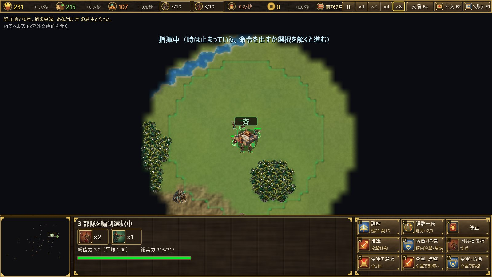

When you select your own units, **time stops**, and 「指揮中」 (Commanding) appears at the top of the screen.

- Time starts again when you give an order (move, attack, gather, build and so on) or clear the selection.
- Time also stops while you drag a selection box.
- Selecting a building does not stop time.

## 9. Diplomacy and coalitions

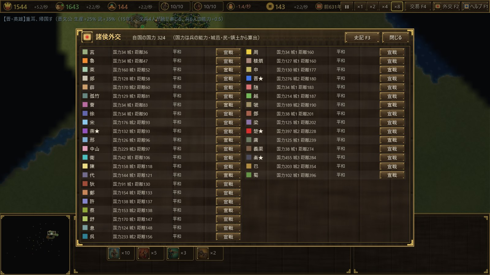

Press **F2** to open Diplomacy (諸侯外交).

- You must **declare war (宣戦)** before you can attack another state.
- You can **propose peace (和睦)** to a state you are at war with. If they offer peace, click **Accept (受諾)**. A truce follows.
- States are listed nearest first, with their strength, number of cities and distance.

**The Hegemon's call (Spring and Autumn)**
Declaring war and taking cities raises the other lords' alarm. When it reaches 100, the strongest state calls on the lords, and your neighbours attack you together for 15 years.

**Vertical alliance (Warring States)**
When one state grows far stronger than the rest, its neighbours ally against it and attack together for 15 years.

## 10. Eras and historical events

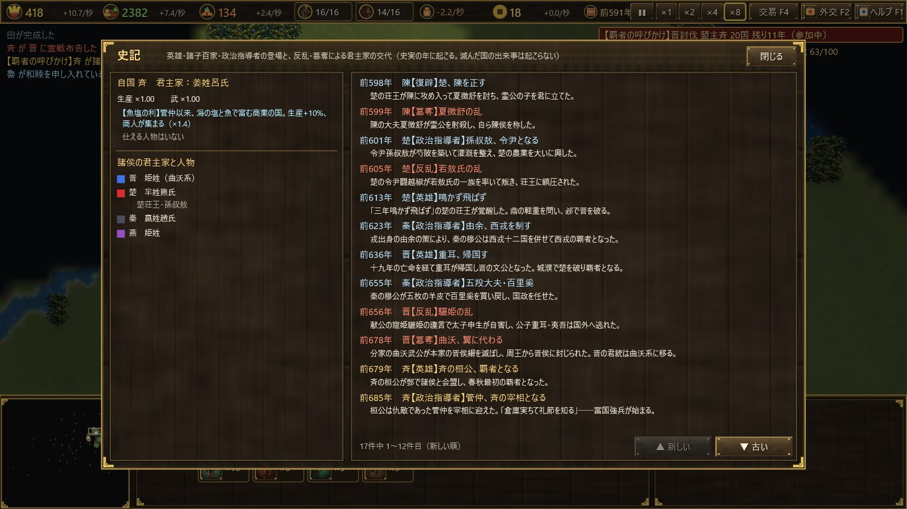

- **Spring and Autumn period** (770–453 BC): 1 year = 4 seconds.
- **Warring States period** (from 453 BC): 1 year = 8 seconds. In 453 BC **the partition of Jin** splits Jin into Han, Zhao and Wei.
- **Era bonuses** are the same for every state, so no single state races ahead.

**Historical events (83 in total)**
- Heroes, philosophers and statesmen appear in their historical year, such as Guan Zhong, Confucius, Sun Tzu, Shang Yang and Bai Qi. They raise the state's production or military strength for some years.
- Revolts and usurpations cost soldiers and stores, and change the ruling house. Examples are Quwo taking Jin, the Tian clan taking Qi, and the Zizhi affair in Yan.
- Some events move diplomacy, such as the vertical and horizontal alliances and the peace conference of 546 BC.
- An event never happens if its state has already been destroyed.

The **Chronicle (F3, 史記)** lists every event that happened or was skipped, each state's ruling house and the figures serving it, and your own state's traits.

## 11. Trade and coin

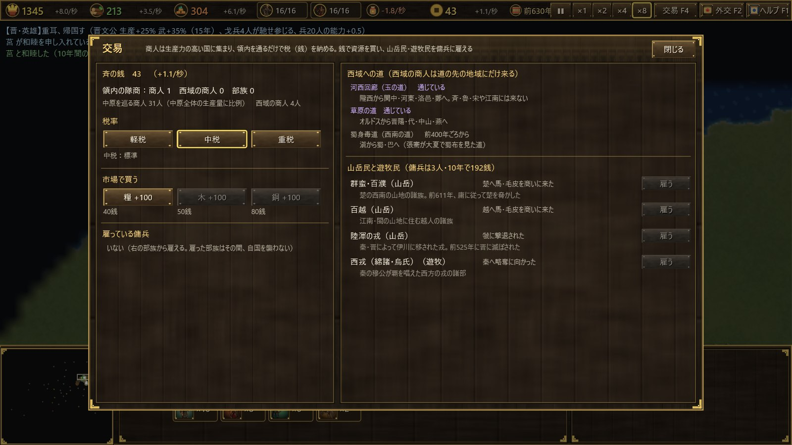

Press **F4** (or click the coin counter) to open Trade (交易).

**Merchants and tax**
- **Merchants** who serve no state travel from city to city. They gather in the most productive states.
- You collect **tax in coin (銭) whenever a merchant is inside your borders**. Merchants pay more while they trade in one of your cities.
- The number of merchants grows with the total production of all China.
- Merchants tend to avoid states at war.

**Tax rate (税率)**

| Rate | Tax | How much merchants are drawn |
|---|---|---|
| Light (軽税) | ×0.6 | ×1.5 |
| Medium (中税) | ×1.0 | ×1.0 |
| Heavy (重税) | ×1.5 | ×0.55 |

**Market (市場)**
Buy 100 of a resource with coin: grain 40, wood 50, bronze 80 coin (Zheng pays 25% less).

## 12. Mountain and steppe peoples, and mercenaries

The mountain and steppe peoples are not states. Each appears only in its own era.

| People | Era (BC) | Type | Homeland |
|---|---|---|---|
| Quanrong (犬戎) | 770–660 | Nomad | West of Mount Long |
| Shanrong (山戎) | 770–640 | Nomad | North of the Yan Mountains |
| Qunman and Baipu (群蛮・百濮) | 770–480 | Mountain | Southwest of Chu |
| Baiyue (百越) | 770–221 | Mountain | Jiangnan and Min |
| Luhun Rong (陸渾の戎) | 638–525 | Mountain | Yi River valley |
| Western Rong (西戎) | 660–330 | Nomad | West of Qin |
| Linhu (林胡) | 560–300 | Nomad | Ordos |
| Donghu (東胡) | 500–221 | Nomad | Northeast of Yan |
| Southwestern Yi (西南夷: Dian, Yelang) | 400–221 | Mountain | Yunnan–Guizhou plateau |
| Yuezhi (月氏) | 400–221 | Nomad | Hexi Corridor |
| Xiongnu (匈奴) | 318–221 | Nomad | North of the Yin Mountains |

- Every few years each people visits a nearby state. If that state is poorly defended, they **raid** it. When they take a city they do not keep it: they carry off about 30% of the stores and coin and ride home.
- If the state is well defended, they come to **trade** horses and furs instead, and pay tax like merchants.
- Click **Hire (雇う)** on the Trade screen to hire 3 **mercenaries** for 10 years. The cost is 150 + 0.3 × years elapsed, in coin. You cannot hire a people that lives too far from your cities, or one that is raiding you right now.
- Mercenaries do not count toward your soldier limit or upkeep, but you cannot train them or turn them into workers.
- While you employ a people, they will not raid you.

## 13. Merchants from the Western Regions

The Western Regions are not a state either. **Western merchants** come only to the regions at the end of their road, and pay three times as much tax as ordinary merchants.

| Road | From | Regions visited |
|---|---|---|
| Hexi Corridor, the Jade Road (河西回廊) | the start | Longxi, Guanzhong, Hedong, Luoyi, Zheng |
| Steppe Road (草原の道) | about 650 BC | Ordos, Jinyang, Dai, Zhongshan, Yan |
| Shu–India Road (蜀身毒道) | about 400 BC | From Dian to Shu and Ba |

Western merchants never reach Qi, Lu, Song or the lands south of the Yangtze.

## 14. State traits

| State | Trait | Effect |
|---|---|---|
| Zhou (周) | Royal Domain | Cannot fall in the Spring and Autumn period (attackers withdraw from its last city). Merchants ×1.3 |
| Jin (晋) | Land of Chariots (Spring and Autumn) | Chariot attack +20%, upkeep −10% |
| Qin (秦) | Passes of Guanzhong | Damage to cities and buildings −30% |
| Qin (秦) | Ranks for Merit (from 356 BC) | Soldier training cost −15% |
| Chu (楚) | Five Thousand Li | Production +10%, halberdier attack +10% |
| Qi (斉) | Fish and Salt | Production +10%, merchants ×1.4 |
| Yan (燕) | Northern Wall | Half the stores lost to raids, cavalry attack +10% |
| Lu (魯) | Rites of Zhou | Training and educating cost −30% |
| Song (宋) | Heirs of Shang | Merchants ×1.6 |
| Wey (衛) | Small-State Wisdom | Damage to cities and buildings −20% |
| Zheng (鄭) | State of Merchants | Market prices −25%, merchants ×1.2 |
| Wu (呉) | Famous Swords | Halberdier attack +25% |
| Yue (越) | Sleeping on Brushwood | Production +10%, upkeep −20% |
| Zhongshan (中山) | Land of a Thousand Chariots | Damage to cities and buildings −25%, cavalry attack +10% |
| Ba (巴) | Ba Warriors | Halberdier attack +20% |
| Shu (蜀) | Land of Abundance | Production +20% |
| Di, Yiqu, Dai, Loufan (狄・義渠・代・楼煩) | Horse Peoples | Chariot and cavalry attack +20%, their training cost −20% |
| Han (韓) | Finest Crossbows | Crossbowman attack +25% |
| Zhao (趙) | Nomad Dress and Mounted Archery (from 307 BC) | Cavalry attack +20%, their training cost −20% |
| Wei (魏) | Wei Wuzu | Halberdier attack +20%, production +5% |

## 15. The Descent of the Supreme Deity (time limit)

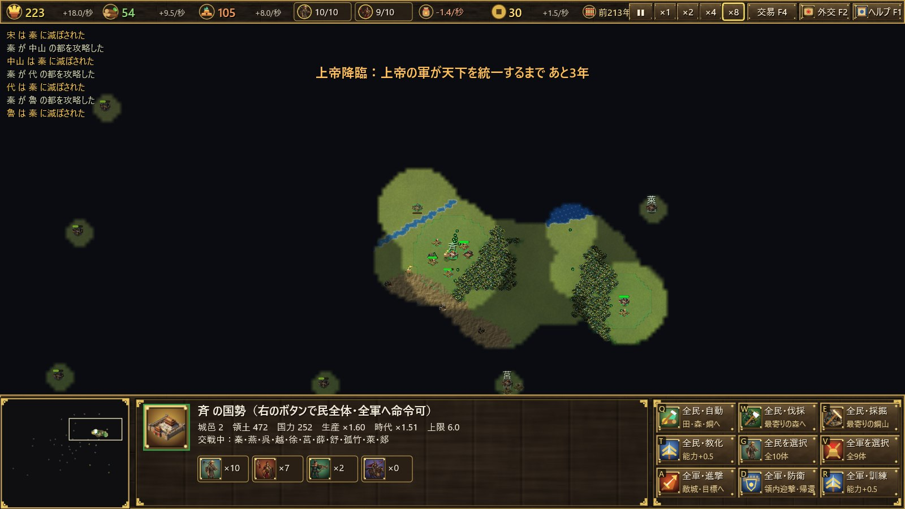

If China is still divided after 221 BC, **the Supreme Deity (上帝) descends upon Qin**.

- If Qin has been destroyed, it rises again at Xianyang.
- The Deity's soldiers cannot be harmed, and Qin will not make peace.
- Every year, more cities pass to Qin, nearest to its capital first, until **all of China is unified within 10 years**.
- The game ends in **forced defeat** when your state falls or when the 10 years are over. Even playing as Qin does not count as a victory.

The top of the screen shows how many years remain. In Heroic Spirits mode you have a way to resist the Deity's army (see [section 16](#16-heroic-spirits-mode-optional)).

## 16. Heroic Spirits mode (optional)

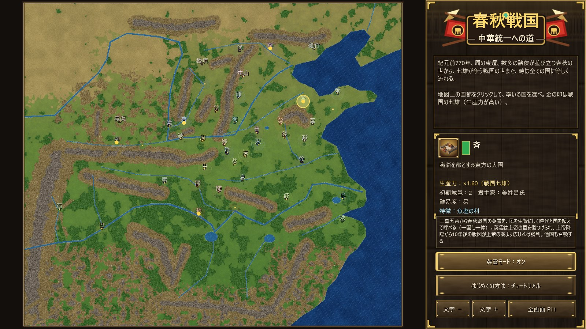

Heroic Spirits mode is **off by default**. Switch 「英霊モード：オフ／オン」 on the title screen before you choose a state and start. It is always off in the tutorial.

**How to summon**
1. Select workers inside your own territory (up to 10).
2. Click **Summon Hero (英霊召喚, H)** at the bottom right of the info panel.
3. Choose a hero and click 「召喚」 (Summon). The selected workers are sacrificed and the hero appears where they stood.

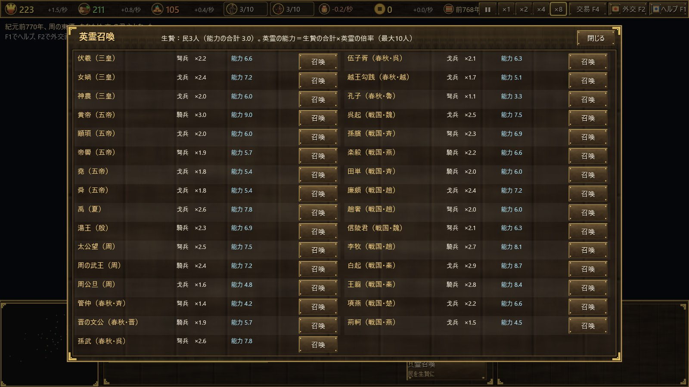

**Rules for heroes**
- You can call 31 heroes, from the Three Sovereigns and Five Emperors to the Warring States, **regardless of era or state**. Qin can call Sun Tzu.
- A hero's power is **the total power of the sacrificed workers × the hero's multiplier (1.1 to 3.0)**. For example, the Yellow Emperor is ×3.0, Bai Qi ×2.9 and Confucius ×1.1. Heroes can exceed the era's power cap.
- Each hero fights as a halberdier, a crossbowman or a cavalryman (chariot).
- **A state can have only one hero at a time.** If your hero falls, you can call another. The same hero never appears for two states at once.
- Heroes do not count toward your soldier limit or upkeep, and they slowly heal. You cannot train them or turn them into workers.
- **Other states summon heroes too**, sacrificing their workers when at war or when the Deity descends.

**Heroes and the Supreme Deity**
- **Only heroes** can harm the Deity's soldiers, and their blows strike three times as hard.
- A state's cities within 15 tiles of its hero are spared from the Deity's yearly conquest. The Deity's soldiers can still take them by force.
- When 10 years have passed since the Descent, **you win if your territory is larger than the Deity's Qin**. Otherwise you lose. Playing as Qin never counts as a win.

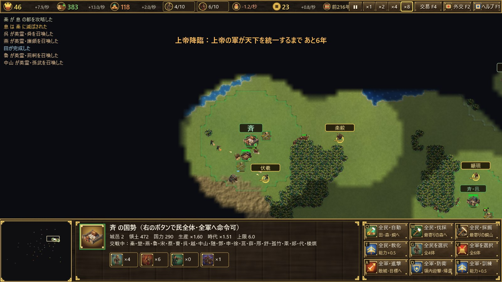

| Heroes | Era | Unit | Multiplier |
|---|---|---|---|
| Fuxi, Nüwa, Shennong | Three Sovereigns | crossbow, halberd, halberd | 2.2, 2.4, 2.0 |
| Yellow Emperor, Zhuanxu, Ku, Yao, Shun | Five Emperors | cavalry, halberd, crossbow, halberd, halberd | 3.0, 2.0, 1.9, 1.8, 1.8 |
| Yu the Great, King Tang | Xia, Shang | halberd, cavalry | 2.6, 2.3 |
| Jiang Ziya, King Wu of Zhou, Duke of Zhou | Zhou | crossbow, cavalry, halberd | 2.5, 2.4, 1.6 |
| Guan Zhong, Duke Wen of Jin, Sun Tzu, Wu Zixu, Goujian, Confucius | Spring and Autumn | crossbow, cavalry, crossbow, halberd, halberd, crossbow | 1.4, 1.9, 2.6, 2.1, 1.7, 1.1 |
| Wu Qi, Sun Bin, Yue Yi, Tian Dan, Lian Po, Zhao She, Lord Xinling | Warring States | halberd, crossbow, cavalry, cavalry, halberd, crossbow, crossbow | 2.5, 2.3, 2.2, 2.0, 2.4, 2.0, 2.1 |
| Li Mu, Bai Qi, Wang Jian, Xiang Yan, Jing Ke | Warring States | cavalry, halberd, cavalry, halberd, halberd | 2.7, 2.9, 2.8, 2.2, 1.5 |

## 17. Keyboard reference

| Key | Action |
|---|---|
| F1 / F2 / F3 / F4 | Help / Diplomacy / Chronicle / Trade |
| H | Summon a hero (Heroic Spirits mode, with workers selected) |
| A | Attack-move |
| S | Stop |
| T | Train / Educate |
| C | Convert soldier ⇔ worker |
| Q / W / E | Build or train (depends on the command panel) |
| Ctrl + number / number | Assign / recall a control group |
| . (period) | Select an idle worker |
| Home | Jump to your capital |
| Space | Pause |
| + / − | Game speed |
| Esc | Cancel / close a screen |
| F11 | Full screen |
| Ctrl + + / Ctrl + − | Text size |

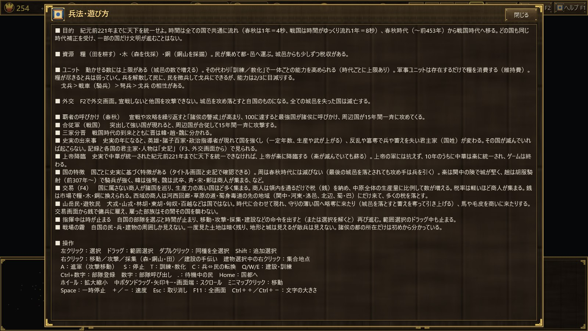

## 18. Tips

- **Start with workers.** Build fields and gather grain, wood and bronze evenly. 「全民・自動」 (all workers – auto) makes this easy.
- **Grow with towns.** Your worker and soldier limits depend on your number of cities, so build towns to expand.
- **Keep a small elite army.** Training units is cheaper in upkeep than raising more of them.
- **Watch the alarm.** Fight too many wars and the Hegemon's call or a vertical alliance will bring everyone down on you.
- **Attract merchants.** Higher production and lighter tax bring more merchants and more coin. Spend coin on missing resources or on mercenaries.
- **Guard the frontier.** Northern and western states should station soldiers against raids, or hire the raiders as mercenaries.
- **Mind the clock.** If you do not unify China by 221 BC, the Deity descends. Plan your expansion once the Warring States period begins.
