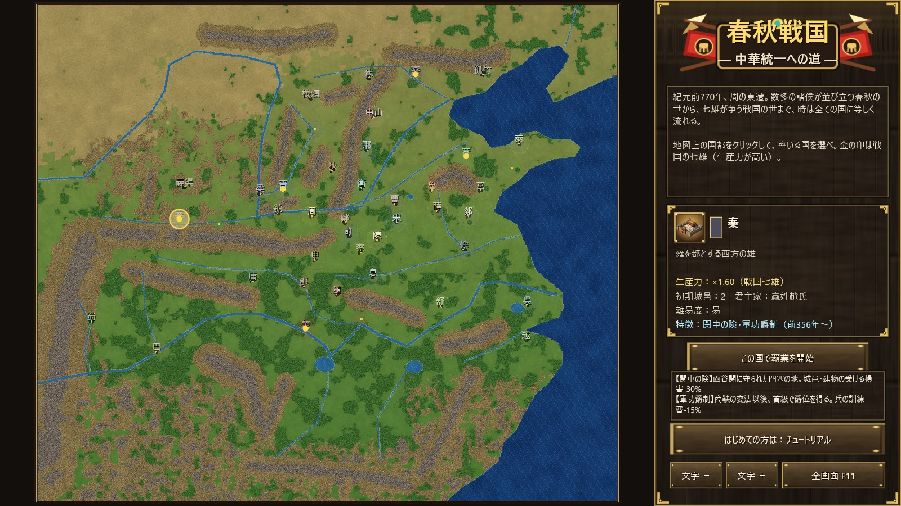
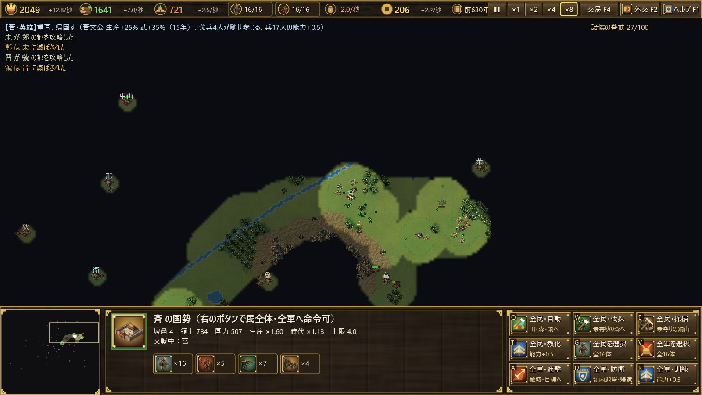

# 春秋戦国 — 中華統一への道

[English](../en/introduction.md) ｜ [中文](../zh/introduction.md) ｜ 日本語

**紀元前770年、周の東遷。** 天子の権威は揺らぎ、数多の諸侯が並び立つ。覇者が会盟を主宰した春秋の世から、七雄が存亡を賭けて争う戦国の世へ。あなたは一国の君主となり、紀元前221年までに天下を統一しなければならない。

『春秋戦国 — 中華統一への道』は、古代中国の550年を舞台にしたリアルタイムストラテジーです。Windows 用で、Rust と Direct3D 11・Direct2D だけで作られています。

## 特徴

### 史実の地図と41の国
黄河の古河道、長江、渭水、淮水。太行・秦嶺・大巴山といった山々。春秋時代の中国を経緯度に沿って再現した広い地図の上に、周・晋・秦・楚・斉・燕から、魯・宋・鄭・衛、呉・越、巴・蜀、北狄・西戎の国々まで、41の国が史実の位置に並びます。秦と蜀の間には褒斜道・金牛道が通っています。

### 国ごとに違う歴史
どの国にも、史実に基づく特徴があります。

- **周**は天子の都で、春秋時代にはどれほど弱っても滅びません。
- **秦**は関中の険に守られて城が堅く、商鞅の変法の後は兵を安く養えます。
- **趙**は胡服騎射（前307年〜）、**韓**は天下の強弩、**魏**は魏武卒で兵が強くなります。
- **斉・宋・鄭**は商人を引き寄せて富みます。

### 史実の出来事83件
管仲・孔子・孫武・商鞅・楽毅・白起といった英雄・諸子百家・政治指導者が、史実の年にその国に現れます。曲沃代翼・田氏代斉・子之の乱などの反乱・簒奪では、君主家（国姓）が変わります。紀元前453年には三家分晋が起き、時代は戦国へ移ります。どの出来事も、その国が既に滅んでいれば起こりません。

### 交易と、国に属さない人々
- **商人**：どの国にも属さない商人が諸国を巡り、生産力の高い国に集まって税（銭）を納めます。
- **西域の商人**：河西回廊・草原の道・蜀身毒道を通って、関中や北辺、蜀にやって来ます。
- **山岳民・遊牧民**：犬戎・山戎・林胡・東胡・匈奴・百越などが時代に合わせて現れ、略奪に来たり、馬を商いに来たりします。銭を払えば傭兵として雇うこともできます。

### 少数精鋭の軍と、止まる時間
- **少数精鋭**：民と兵の数には上限があります。その代わり、一体ずつ訓練・教化して強くします。兵は存在するだけで糧を食います。
- **兵の相性**：戈兵・戦車（騎兵）・弩兵の三すくみです。
- **止まる時間**：自国の部隊を選んでいる間は時間が止まるので、落ち着いて指揮できます。
- **戦国の時間**：戦国時代になると時間の流れがゆっくりになります。

### 天命の期限
史実で中華が統一された紀元前221年までに天下を取れなければ、上帝が秦に降臨します。秦が滅んでいても蘇り、上帝の軍には誰も抗えません。歴史はあなたを待ってくれません。

## 遊ぶには

- 動作環境は Windows 10／11（Direct3D 11 対応）です。
- 遊び方は[ユーザーガイド](user-guide.md)をご覧ください。初めての方は、タイトル画面の「チュートリアル」で操作を1段ずつ学べます。
