# ユーザーガイド — 春秋戦国 中華統一への道

[English](../en/user-guide.md) ｜ [中文](../zh/user-guide.md) ｜ 日本語

ゲームの紹介は[こちら](introduction.md)です。

## 目次

1. [インストールと起動](#1-インストールと起動)
2. [ゲームの目的](#2-ゲームの目的)
3. [国を選ぶ](#3-国を選ぶ)
4. [画面の見かた](#4-画面の見かた)
5. [基本操作](#5-基本操作)
6. [経済：資源・民・建物](#6-経済資源民建物)
7. [軍事：兵種・訓練・維持費](#7-軍事兵種訓練維持費)
8. [指揮中は時が止まる](#8-指揮中は時が止まる)
9. [外交と連合](#9-外交と連合)
10. [時代と史実の出来事](#10-時代と史実の出来事)
11. [交易と銭](#11-交易と銭)
12. [山岳民・遊牧民と傭兵](#12-山岳民遊牧民と傭兵)
13. [西域の商人](#13-西域の商人)
14. [国の特徴](#14-国の特徴)
15. [上帝降臨（時間切れ）](#15-上帝降臨時間切れ)
16. [英霊モード（オプション）](#16-英霊モードオプション)
17. [キー操作一覧](#17-キー操作一覧)
18. [攻略のヒント](#18-攻略のヒント)

---

## 1. インストールと起動

**動作環境**：Windows 10／11、Direct3D 11 に対応したグラフィックス。

**ビルド済みの exe を使う場合**
1. GitHub リポジトリの **Actions** を開き、ワークフロー「build」の成功した実行を選びます。
2. **Artifacts** の `yyempire-windows` をダウンロードして展開します。
3. `yyempire.exe` を実行します。画像などの素材は exe に埋め込まれているので、この1ファイルだけで遊べます。

**ソースからビルドする場合**（Rust が必要）

```
cargo run --release
```

文字が小さいときは **Ctrl＋＋／Ctrl＋−**（またはタイトル画面の「文字 ＋／−」）で拡大縮小できます。**F11** で全画面になります。

## 2. ゲームの目的

紀元前770年から始まり、**紀元前221年までに他のすべての国を滅ぼして天下を統一する**と勝利です。

- 時間はすべての国で共通に流れます。春秋時代は1年＝4秒です。
- 紀元前453年に戦国時代へ移ると、時間はゆっくりになり1年＝8秒になります。
- 自国の城邑をすべて失うと滅亡し、敗北です。
- 紀元前221年までに統一できなければ「[上帝降臨](#15-上帝降臨時間切れ)」が起こり、強制的にゲームオーバーになります。

## 3. 国を選ぶ


地図上の国都をクリックすると、右のパネルにその国の説明が出ます。

- **生産力**：城邑からの税や採集の効率です。金の印の国は戦国七雄で、生産力が ×1.6 と高めです。
- **初期城邑・君主家**：最初に持つ城邑の数と、君主家（国姓）です。君主家は反乱や簒奪で変わることがあります。
- **難易度**：七雄は易しく、小国は難しくなります。
- **特徴**：その国の史実に基づく特徴です。行にカーソルを当てると説明が出ます（[14章](#14-国の特徴)）。

「この国で覇業を開始」で始まります。初めての方は「**はじめての方は：チュートリアル**」がおすすめです。晋で始まり、22段で操作を1つずつ学べます。

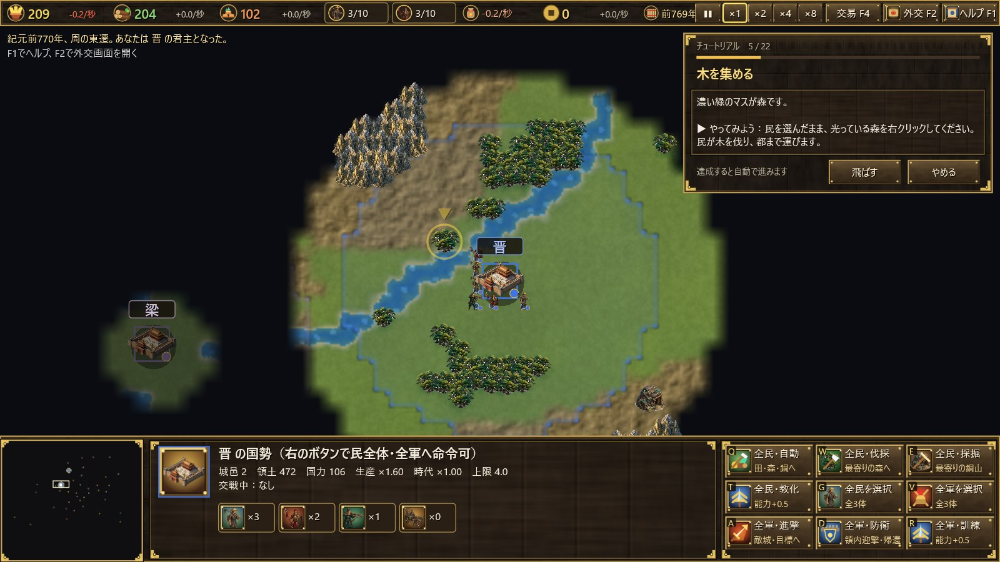

## 4. 画面の見かた

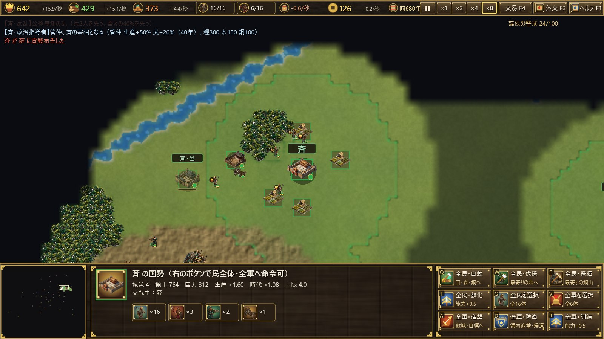

**上部バー（左から）**

| 項目 | 内容 |
|---|---|
| 糧・木・銅 | 蓄えと1秒あたりの増減（糧は維持費を差し引いた値） |
| 民 n/上限 | クリックすると民全体を選ぶ |
| 兵 n/上限 | クリックすると全軍を選ぶ |
| 維持費 | 軍が1秒に食う糧 |
| 銭 | 商人からの税収。クリックで交易画面 |
| 年 | 紀元前の年と時代 |
| 速度 | 一時停止・×1・×2・×4・×8 |
| 交易 F4／外交 F2／ヘルプ F1 | 各画面を開く |

**下部パネル**：左がミニマップ（クリックでその場所へ移動）、中央が選択中のユニットや建物の情報、右がコマンドボタンです（ボタンの左上の文字がショートカットキー）。

**地図**
- 国ごとの色の線が領土の境界です。
- **戦場の霧**：自国の民・兵・建物の周りしか見えません。一度見た土地は暗く残り、地形と城は見えますが、敵兵は見えません。諸侯の都の位置だけは最初から分かっています。
- 小旗のついた牛車は中原の商人、駱駝は西域の商人、馬は部族の隊商です。

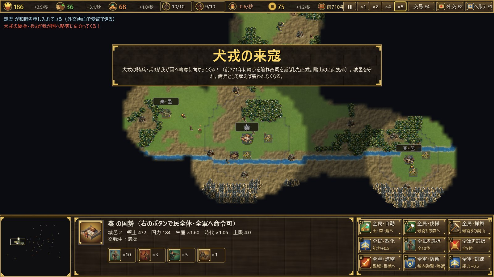

## 5. 基本操作

| 操作 | 内容 |
|---|---|
| 左クリック | ユニット・建物を選ぶ |
| ドラッグ | 範囲選択 |
| ダブルクリック | 同じ種類のユニットをまとめて選ぶ |
| Shift＋クリック | 選択に加える |
| 右クリック | 移動、攻撃、採集（森・銅山・田）、建設の手伝い |
| 建物を選んで右クリック | 集合地点を設定 |
| ホイール | 拡大縮小 |
| 中ボタンドラッグ・矢印キー・画面端 | スクロール |
| Home | 国都へ |
| Space | 一時停止 |

ボタンにカーソルを当てると説明（ツールチップ）が出ます。

## 6. 経済：資源・民・建物

**資源**は3種類です。
- **糧**：田を耕して得ます。民と兵の訓練、軍の維持に使います。
- **木**：森を伐採して得ます。建物と弓・戦車に使います。
- **銅**：銅山を採掘して得ます。兵と邑に使います。

**民**が資源を集め、都・邑へ運びます。都・邑からも、少しずつ税が入ります。

| 建物 | 費用（糧/木/銅） | 役割 |
|---|---|---|
| 都 | — | 国の中心。民を訓練する。失うと別の邑に遷都 |
| 邑 | 100／250／80 | 領土を広げ、民・兵の上限を上げる。民を訓練する。他の城邑から9以上離し、自国の城邑から26以内に置く |
| 兵営 | 0／150／30 | 軍事ユニットを訓練する |
| 田 | 0／60／0 | 民が耕すと糧を産む |

建物は自国の領内に置きます。民を選んでコマンド欄の Q／W／E（田・兵営・邑）を押し、置く場所をクリックします。

**民・兵の上限**は、それぞれ「4＋3×城邑の数」です（最大25）。邑を増やすほど国は大きくなります。

便利なコマンド：
- **自動採集（F）**：選んだ民を、空いている田・森・銅山へ配分します。
- **全民・自動／伐採／採掘**：すべての民にまとめて指示します。
- **.（ピリオド）**：手の空いている民を選びます。

## 7. 軍事：兵種・訓練・維持費

| 兵種 | 費用（糧/木/銅） | 特徴 |
|---|---|---|
| 民 | 50／0／0 | 生産ユニット。戦闘は弱い |
| 戈兵 | 60／0／25 | 歩兵。戦車・騎兵に強く、建物攻撃に優れる |
| 弩兵 | 50／35／15 | 遠距離攻撃。歩兵に強いが、戦車・騎兵に弱い |
| 戦車（戦国期は騎兵） | 80／45／40 | 高速の突撃兵。弩兵と民に強く、戈兵に弱い |

相性は **戈兵 ＞ 戦車（騎兵） ＞ 弩兵 ＞ 戈兵** です。

- **訓練・教化（T）**：自国の領内で、ユニット1体の能力を＋0.5 高めます。費用は今の能力に比例します。能力の上限は、春秋時代が4.0、戦国時代が6.0です。
- **兵⇔民の転換（C）**：兵を解散して民にしたり、民を徴兵して戈兵にしたりします。能力は2/3に下がります。
- **維持費**：兵は存在するだけで、1秒あたり「0.07×能力」の糧を食います。糧が尽きると兵は弱っていきます。
- **進軍（A）**：攻撃移動です。道中の敵と戦いながら進みます。
- **防衛・帰還（D）**：領内に入った敵を迎え撃ち、国都へ集まります。
- **部隊登録**：Ctrl＋数字で登録し、数字キーで呼び出します。

城邑の耐久を0にすると、その城邑を奪えます。

## 8. 指揮中は時が止まる

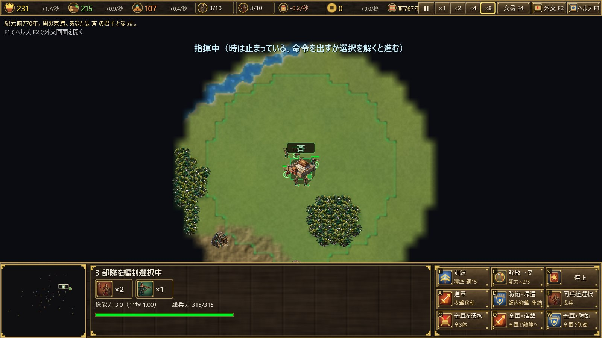

自国の部隊を選ぶと、**時間が止まります**。画面上部に「指揮中」と出ます。

- 移動・攻撃・採集・建設などの命令を出すか、選択を解くと、時間は再び進みます。
- 範囲選択でドラッグしている間も止まります。
- 建物を選んでいる間は止まりません。

## 9. 外交と連合

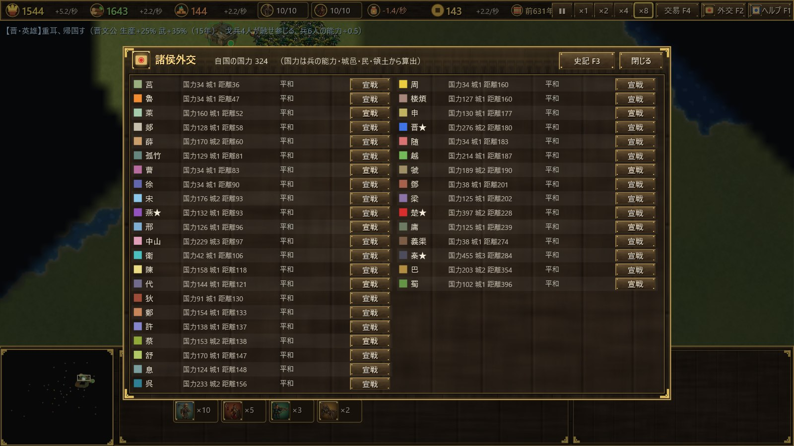

**F2** で外交画面を開きます。

- 他国を攻撃するには、まず**宣戦**が必要です。
- 戦争中の国には**和睦**を申し入れられます。相手から申し入れがあれば「受諾」で和睦できます。和睦の後はしばらく休戦です。
- 国の並びは自国から近い順です。国力・城邑の数・距離が表示されます。

**覇者の呼びかけ（春秋時代）**
宣戦や攻略を繰り返すと「諸侯の警戒」が高まります。100に達すると、最強国が諸侯に呼びかけ、周辺国が15年間一斉に攻めてきます。

**合従軍（戦国時代）**
突出して強い国が現れると、周辺国が合従して15年間一斉に攻撃します。

## 10. 時代と史実の出来事

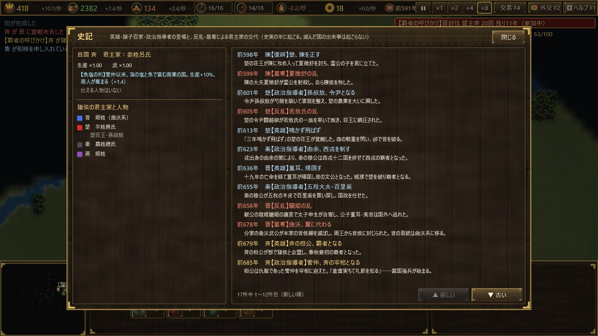

- **春秋時代**（前770〜前453年）：1年＝4秒です。
- **戦国時代**（前453年〜）：1年＝8秒です。前453年に**三家分晋**が起き、晋は韓・趙・魏に分かれます。
- **時代補正**は全国共通で、一部の国だけが進むことはありません。

**史実の出来事（83件）**
- 史実の年に、英雄・諸子百家・政治指導者が現れます（管仲・孔子・孫武・商鞅・白起など）。一定年数、その国の生産や武が上がります。
- 反乱や簒奪が起きると、兵や蓄えを失い、君主家（国姓）が変わります（曲沃代翼、田氏代斉、子之の乱など）。
- 合従・連衡・弭兵の会など、外交が動く出来事もあります。
- その国が既に滅んでいれば、出来事は起こりません。

**史記（F3）** では、起きた出来事と起こらなかった出来事の記録、各国の君主家と仕える人物、自国の特徴が見られます。

## 11. 交易と銭

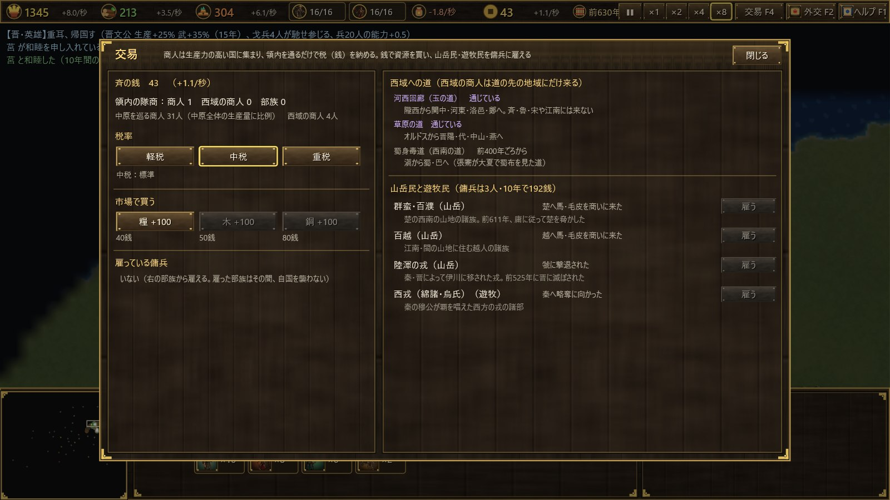

**F4**（または上部バーの銭）で交易画面を開きます。

**商人と税**
- どの国にも属さない**商人**が諸国の城邑を巡ります。生産力の高い国ほど多く集まります。
- 商人が**領内を通るだけで税（銭）**が入ります。城邑で商いをしている間は、税が多くなります。
- 商人の数は、中原全体の生産量に比例して増えます。
- 戦争中の国には、商人が寄りつきにくくなります。

**税率**

| 税率 | 税 | 商人の集まりやすさ |
|---|---|---|
| 軽税 | ×0.6 | ×1.5 |
| 中税 | ×1.0 | ×1.0 |
| 重税 | ×1.5 | ×0.55 |

**市場**
銭で資源を100ずつ買えます。値段は糧40・木50・銅80銭です（鄭は25%安い）。

## 12. 山岳民・遊牧民と傭兵

山岳民と遊牧民は国ではありません。史実の年代にだけ現れます。

| 部族 | 年代（紀元前） | 種類 | 本拠 |
|---|---|---|---|
| 犬戎 | 770〜660 | 遊牧 | 隴山の西 |
| 山戎 | 770〜640 | 遊牧 | 燕山の北 |
| 群蛮・百濮 | 770〜480 | 山岳 | 楚の西南 |
| 百越 | 770〜221 | 山岳 | 江南・閩 |
| 陸渾の戎 | 638〜525 | 山岳 | 伊川 |
| 西戎（綿諸・烏氏） | 660〜330 | 遊牧 | 秦の西 |
| 林胡 | 560〜300 | 遊牧 | オルドス |
| 東胡 | 500〜221 | 遊牧 | 燕の北東 |
| 西南夷（滇・夜郎） | 400〜221 | 山岳 | 雲貴高原 |
| 月氏 | 400〜221 | 遊牧 | 河西 |
| 匈奴 | 318〜221 | 遊牧 | 陰山の北 |

- 部族は数年ごとに近くの国へやって来ます。守りが薄い国には**略奪**に来ます。城邑を落としても占領はせず、蓄えの約3割と銭を奪って引き上げます。
- 守りが固い国には、馬や毛皮を**商い**に来て税を落とします。
- 交易画面の「**雇う**」で、銭を払って**傭兵**を3人・10年雇えます。費用は「150＋経過年×0.3」銭です。自国の城邑から遠すぎる部族や、自国を襲っている最中の部族は雇えません。
- 傭兵は兵数の上限や維持費に数えません。ただし、訓練や民への転換はできません。
- 雇っている間、その部族は自国を襲いません。

## 13. 西域の商人

西域も国ではありません。**西域の商人**は、決まった道の先の地域にだけやって来て、普通の商人の3倍の税を落とします。

| 道 | 来る時期 | 訪れる地域 |
|---|---|---|
| 河西回廊（玉の道） | はじめから | 隴西・関中・河東・洛邑・鄭 |
| 草原の道 | 前650年ごろから | オルドス・晋陽・代・中山・燕 |
| 蜀身毒道（西南の道） | 前400年ごろから | 滇から蜀・巴 |

斉・魯・宋や江南には、西域の商人は来ません。

## 14. 国の特徴

| 国 | 特徴 | 効果 |
|---|---|---|
| 周 | 天子の王畿 | 春秋時代は滅びない（最後の城邑を落とされても攻め手は兵を引く）。商人×1.3 |
| 晋 | 戦車の大国（春秋） | 戦車の攻撃＋20%、維持費−10% |
| 秦 | 関中の険 | 城邑・建物の受ける損害−30% |
| 秦 | 軍功爵制（前356年〜） | 兵の訓練費−15% |
| 楚 | 地方五千里 | 生産＋10%、戈兵の攻撃＋10% |
| 斉 | 魚塩の利 | 生産＋10%、商人×1.4 |
| 燕 | 北辺の守り | 部族の略奪で失う蓄えが半分、騎兵の攻撃＋10% |
| 魯 | 周礼尽く魯に在り | 訓練・教化の費用−30% |
| 宋 | 殷の後裔 | 商人×1.6 |
| 衛 | 小国の知恵 | 城邑・建物の受ける損害−20% |
| 鄭 | 商人の国 | 市場の値−25%、商人×1.2 |
| 呉 | 呉越の名剣 | 戈兵の攻撃＋25% |
| 越 | 臥薪嘗胆 | 生産＋10%、維持費−20% |
| 中山 | 千乗の国 | 城邑・建物の受ける損害−25%、騎兵の攻撃＋10% |
| 巴 | 巴師の勇 | 戈兵の攻撃＋20% |
| 蜀 | 天府の国 | 生産＋20% |
| 狄・義渠・代・楼煩 | 騎馬の民 | 戦車・騎兵の攻撃＋20%、訓練費−20% |
| 韓 | 天下の強弓勁弩 | 弩兵の攻撃＋25% |
| 趙 | 胡服騎射（前307年〜） | 騎兵の攻撃＋20%、訓練費−20% |
| 魏 | 魏武卒 | 戈兵の攻撃＋20%、生産＋5% |

## 15. 上帝降臨（時間切れ）

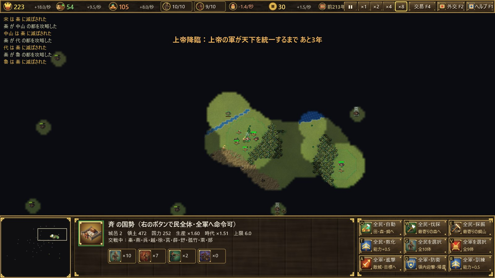

紀元前221年が過ぎても天下が統一されていないと、**上帝が秦に降臨**します。

- 秦が滅んでいれば、咸陽で蘇ります。
- 上帝の軍は傷つかず、秦とは和睦もできません。
- 秦の都に近い城邑から順に、毎年秦のものになり、**10年で中華は統一**されます。
- 自国が滅んだ時点か、10年たった時点で**強制的にゲームオーバー**です。自分が秦でも勝利にはなりません。

残りの年数は画面上部に表示されます。英霊モードでは、上帝の軍に抗う道があります（[16章](#16-英霊モードオプション)）。

## 16. 英霊モード（オプション）

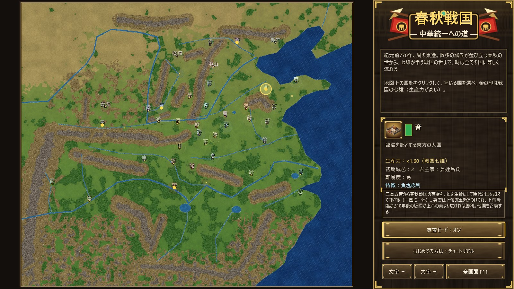

英霊モードは**既定では無効**です。タイトル画面の「**英霊モード：オフ／オン**」で切り替えてから国を選んで始めます（チュートリアルでは無効）。

**召喚のしかた**
1. 自国領内にいる民を選びます（最大10人）。
2. 情報欄の右下の「**英霊召喚**」（H）を押します。
3. 一覧から英霊を選んで「召喚」を押すと、選んだ民が生贄となり、その場に英霊が現れます。

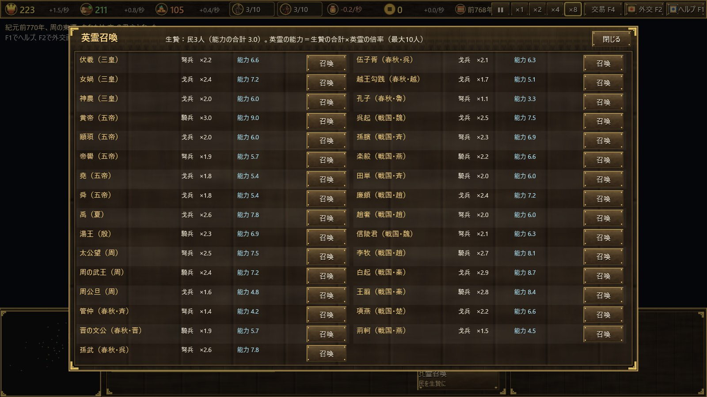

**英霊のきまり**
- 三皇五帝から春秋戦国まで、31人の英霊を**時代と国を超えて**呼べます。秦の国でも孫武を呼べます。
- 英霊の能力は「**生贄にした民の能力の合計 × 英霊ごとの倍率（1.1〜3.0）**」です。たとえば黄帝は×3.0、白起は×2.9、孔子は×1.1です。時代の能力上限を超えられます。
- 兵種は英霊によって戈兵・弩兵・騎兵（戦車）のいずれかです。
- **一国が同時に従えられる英霊は一体だけ**です。英霊が倒れれば、また呼べます。同じ英霊が二国に同時に現れることはありません。
- 英霊は兵数の上限と維持費に数えません。少しずつ傷が癒えます。訓練や民への転換はできません。
- **他国も英霊を召喚**します。戦争中や上帝降臨のときに、民を生贄にして呼びます。

**英霊と上帝**
- 上帝の兵を傷つけられるのは**英霊だけ**で、その一撃は3倍効きます。
- 英霊の近く（15マス以内）にある、その国の城邑は、上帝の軍の予定の攻略から外れます。ただし、上帝の兵に攻め落とされることはあります。
- 上帝降臨から10年たったとき、**自国の版図（領土）が上帝の秦より広ければ勝利**です。狭ければ敗北です。自分が秦の場合は勝利になりません。

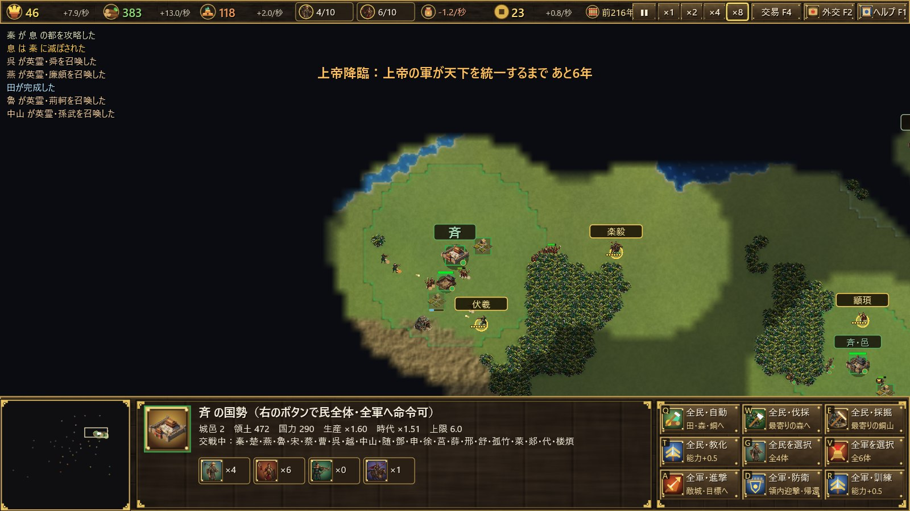

| 英霊 | 時代 | 兵種 | 倍率 |
|---|---|---|---|
| 伏羲・女媧・神農 | 三皇 | 弩・戈・戈 | 2.2・2.4・2.0 |
| 黄帝・顓頊・帝嚳・堯・舜 | 五帝 | 騎・戈・弩・戈・戈 | 3.0・2.0・1.9・1.8・1.8 |
| 禹・湯王 | 夏・殷 | 戈・騎 | 2.6・2.3 |
| 太公望・周の武王・周公旦 | 周 | 弩・騎・戈 | 2.5・2.4・1.6 |
| 管仲・晋の文公・孫武・伍子胥・越王勾践・孔子 | 春秋 | 弩・騎・弩・戈・戈・弩 | 1.4・1.9・2.6・2.1・1.7・1.1 |
| 呉起・孫臏・楽毅・田単・廉頗・趙奢・信陵君 | 戦国 | 戈・弩・騎・騎・戈・弩・弩 | 2.5・2.3・2.2・2.0・2.4・2.0・2.1 |
| 李牧・白起・王翦・項燕・荊軻 | 戦国 | 騎・戈・騎・戈・戈 | 2.7・2.9・2.8・2.2・1.5 |

## 17. キー操作一覧

| キー | 内容 |
|---|---|
| F1／F2／F3／F4 | ヘルプ／外交／史記／交易 |
| H | 英霊召喚（英霊モードで民を選んでいるとき） |
| A | 進軍（攻撃移動） |
| S | 停止 |
| T | 訓練・教化 |
| C | 兵⇔民の転換 |
| Q／W／E | 建設・訓練（コマンド欄の位置による） |
| Ctrl＋数字／数字 | 部隊登録／部隊呼び出し |
| .（ピリオド） | 手の空いている民 |
| Home | 国都へ |
| Space | 一時停止 |
| ＋／− | ゲーム速度 |
| Esc | 取り消し・画面を閉じる |
| F11 | 全画面 |
| Ctrl＋＋／Ctrl＋− | 文字の大きさ |

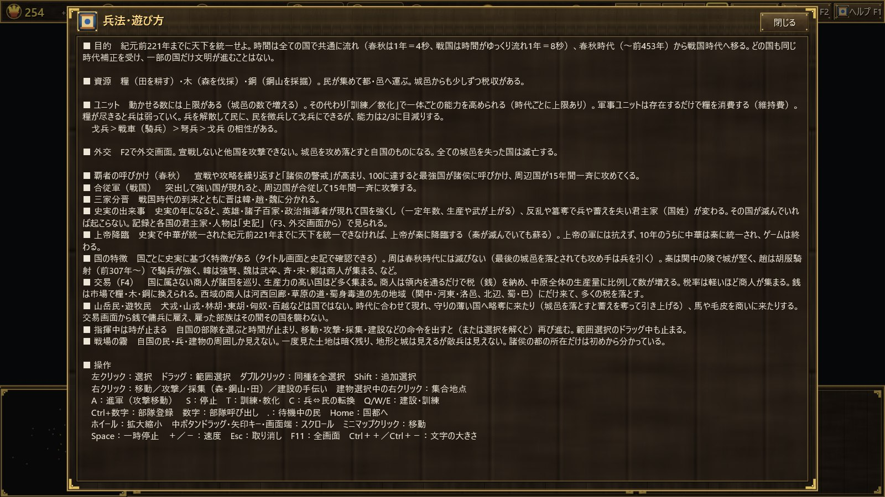

## 18. 攻略のヒント

- **最初は民を増やす**：田を作り、民で糧・木・銅をバランスよく集めます。「全民・自動」が便利です。
- **邑で国を広げる**：民・兵の上限は城邑の数で決まります。邑を建てて領土を広げましょう。
- **兵は少数精鋭で**：数を増やすより、訓練で能力を上げるほうが維持費を抑えられます。
- **警戒に注意**：戦争を繰り返すと、覇者の呼びかけや合従軍で周りじゅうから攻められます。
- **商人を呼ぶ**：生産力を上げて税を軽くすると、商人が集まって銭が増えます。銭は足りない資源の購入や傭兵に使えます。
- **国境の部族に備える**：北方や西方の国は、略奪に備えて兵を置くか、部族を傭兵として雇いましょう。
- **時間を意識する**：前221年までに統一しなければ、上帝が降臨します。戦国時代に入ったら、計画的に拡大しましょう。
