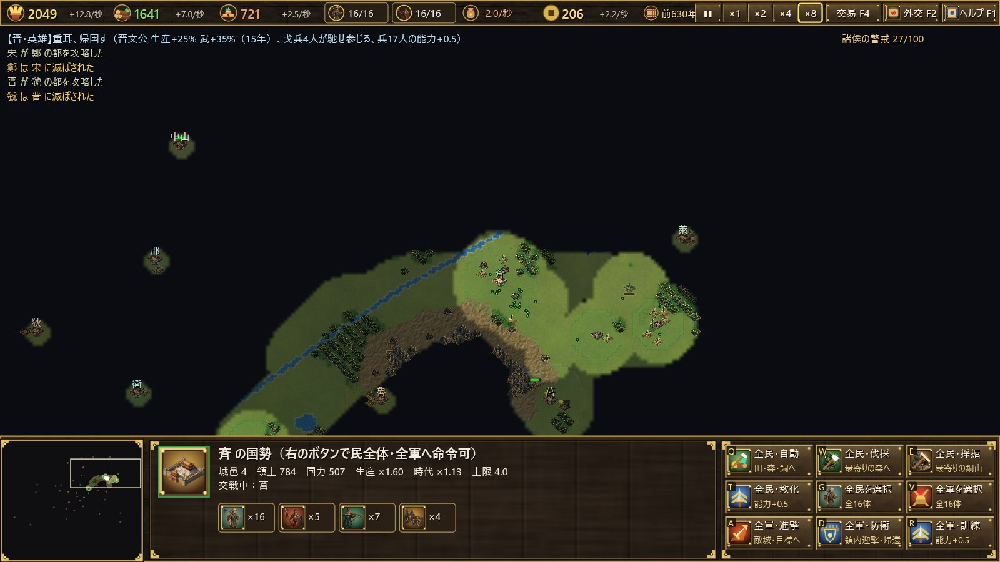

# 春秋战国——中华统一之路

[English](../en/introduction.md) ｜ 中文 ｜ [日本語](../ja/introduction.md)

**公元前770年，周室东迁。** 天子威权日衰，诸侯并起。从霸主主持会盟的春秋之世，到七雄存亡相搏的战国之世，你将成为一国之君，必须在公元前221年之前一统天下。

《春秋战国——中华统一之路》是一款以中国古代550年历史为舞台的即时战略游戏。游戏运行于 Windows，仅用 Rust、Direct3D 11 和 Direct2D 从零打造。

> 目前游戏内文字为日语。本指南用中文说明每个画面。

## 特色

### 依史实绘制的地图与41国
黄河古道、长江、渭水、淮水流经地图，太行、秦岭、大巴诸山横亘其间。地图按真实经纬度再现春秋时代的中国。周、晋、秦、楚、齐、燕，以及鲁、宋、郑、卫，吴、越，巴、蜀，北狄、西戎诸国，共41国按史实位置分布。秦与蜀之间有褒斜道、金牛道相通。

### 各国各有其历史
每个国家都有依据史实的特点。

- **周**是天子之都，春秋时代无论多么衰弱都不会灭亡。
- **秦**有关中之险，城池坚固；商鞅变法之后，养兵成本更低。
- **赵**有胡服骑射（前307年起），**韩**有天下劲弩，**魏**有魏武卒，兵力因此更强。
- **齐、宋、郑**吸引商人，以商致富。

### 83个史实事件
管仲、孔子、孙武、商鞅、乐毅、白起等英雄、诸子百家与政治家，会在史实年份出现在其国。曲沃代翼、田氏代齐、子之之乱等叛乱与篡夺会更换君主之家。公元前453年三家分晋，时代进入战国。若该国已经灭亡，相应事件便不会发生。

### 贸易与不属于任何国家的人们
- **商人**：不属于任何国家的商人周游列国，聚集在生产力高的国家，向你缴纳税钱。
- **西域商人**：沿河西走廊、草原之路、蜀身毒道而来，到访关中、北边与蜀地。
- **山民与游牧民**：犬戎、山戎、林胡、东胡、匈奴、百越等随时代出现，或来劫掠，或来贩马。付钱即可雇为佣兵。

### 少而精的军队，等待你的时间
- **少而精**：民与兵的数量有上限，只能逐一训练使其变强。士兵只要存在就要消耗粮食。
- **兵种相克**：戈兵、战车（骑兵）、弩兵三者相克。
- **时间暂停**：选中己方部队时时间暂停，让你从容指挥。
- **战国的时间**：进入战国时代后，时间流逝变慢。

### 天命的期限
史实上中国于公元前221年统一。若届时你仍未取得天下，上帝便降临于秦。即便秦已灭亡也会复活，无人能抵挡上帝之军。历史不会等你。

## 开始游戏

- 运行环境为 Windows 10／11（支持 Direct3D 11）。
- 玩法请参阅[用户指南](user-guide.md)。初次游玩可从标题画面进入“教程”，逐步学习操作。
