# 用户指南——春秋战国：中华统一之路

[English](../en/user-guide.md) ｜ 中文 ｜ [日本語](../ja/user-guide.md)

游戏介绍请见[这里](introduction.md)。

> 游戏内文字为日语。本指南在方括号中注明画面上的日语标签，如“外交（外交）”，方便你在画面上找到对应按钮。

## 目录

1. [安装与启动](#1-安装与启动)
2. [游戏目标](#2-游戏目标)
3. [选择国家](#3-选择国家)
4. [画面说明](#4-画面说明)
5. [基本操作](#5-基本操作)
6. [经济：资源、民、建筑](#6-经济资源民建筑)
7. [军事：兵种、训练、维持费](#7-军事兵种训练维持费)
8. [指挥时时间暂停](#8-指挥时时间暂停)
9. [外交与联盟](#9-外交与联盟)
10. [时代与史实事件](#10-时代与史实事件)
11. [贸易与钱](#11-贸易与钱)
12. [山民、游牧民与佣兵](#12-山民游牧民与佣兵)
13. [西域商人](#13-西域商人)
14. [国家特点](#14-国家特点)
15. [上帝降临（时间到）](#15-上帝降临时间到)
16. [英灵模式（可选）](#16-英灵模式可选)
17. [按键一览](#17-按键一览)
18. [攻略提示](#18-攻略提示)

---

## 1. 安装与启动

**运行环境**：Windows 10／11，支持 Direct3D 11 的显卡。

**使用已构建的 exe**
1. 打开 GitHub 仓库的 **Actions**，选择“build”工作流中一次成功的运行。
2. 下载 **Artifacts** 中的 `yyempire-windows` 并解压。
3. 运行 `yyempire.exe`。图片等素材都已嵌入 exe，只需这一个文件即可游玩。

**从源码构建**（需要 Rust）

```
cargo run --release
```

文字太小时，按 **Ctrl＋＋／Ctrl＋−**（或使用标题画面的“文字 ＋／−”）缩放。按 **F11** 切换全屏。

## 2. 游戏目标

游戏从公元前770年开始。**在公元前221年之前消灭其他所有国家、一统天下**即为胜利。

- 时间对所有国家同样流逝。春秋时代1年＝4秒。
- 公元前453年进入战国时代后，时间变慢，1年＝8秒。
- 失去所有城邑即亡国，游戏失败。
- 若到公元前221年仍未统一，将发生“[上帝降临](#15-上帝降临时间到)”，游戏强制结束。

## 3. 选择国家


点击地图上的国都，右侧面板会显示该国的说明。

- **生产力（生産力）**：城邑税收与采集的效率。带金色标记的是战国七雄，生产力为 ×1.6。
- **初始城邑・君主之家（初期城邑・君主家）**：君主之家（国姓）可能因叛乱或篡夺而改变。
- **难度（難易度）**：七雄较易，小国较难。
- **特点（特徴）**：该国依据史实的特点。把光标移到这一行可看到说明（见[第14章](#14-国家特点)）。

点击“この国で覇業を開始”（以此国开始霸业）即可开始。初次游玩推荐“はじめての方は：チュートリアル”（教程）。以晋国开始，分22步逐一学习操作。

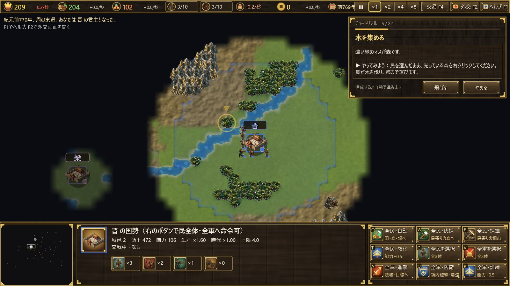

## 4. 画面说明

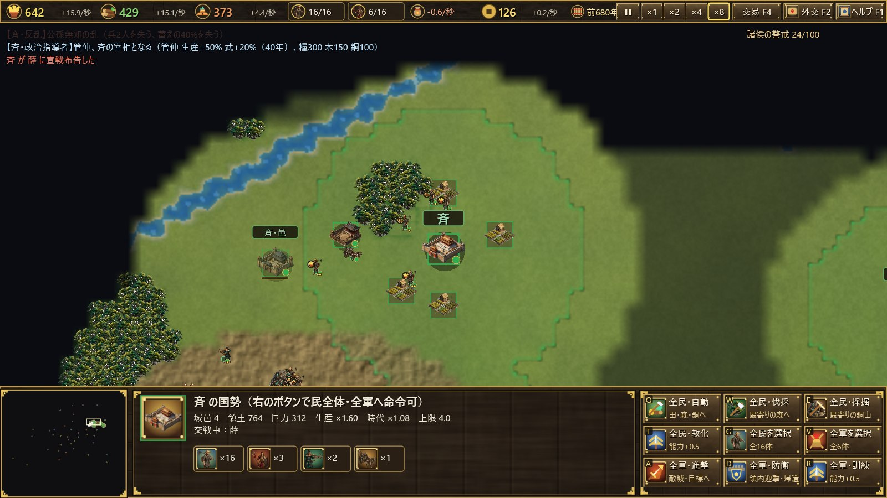

**顶部栏（从左到右）**

| 项目 | 内容 |
|---|---|
| 粮・木・铜（糧・木・銅） | 存量与每秒增减（粮为扣除维持费后的数值） |
| 民 n/上限 | 点击选中全部民 |
| 兵 n/上限 | 点击选中全军 |
| 维持费 | 军队每秒消耗的粮 |
| 钱（銭） | 商人的税收。点击打开贸易画面 |
| 年份 | 公元前年份与时代 |
| 速度 | 暂停・×1・×2・×4・×8 |
| 贸易 F4（交易）／外交 F2（外交）／帮助 F1（ヘルプ） | 打开各画面 |

**底部面板**：左侧是小地图（点击可跳转），中间显示所选单位或建筑的信息，右侧是命令按钮（按钮左上角的字母是快捷键）。

**地图**
- 各国颜色的线是领土边界。
- **战争迷雾**：只能看到己方民、兵、建筑周围。看过的土地会变暗保留，仍可看到地形与城池，但看不到敌兵。各国国都的位置从一开始就已知。
- 插小旗的牛车是商人，骆驼是西域商人，马是部族商队。

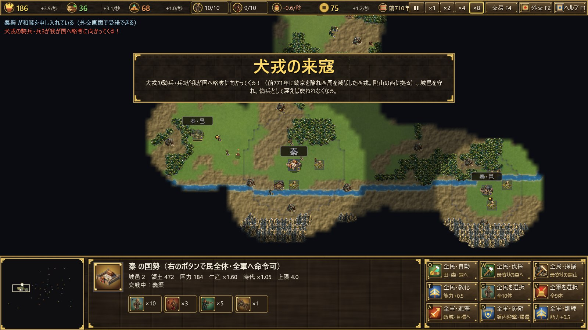

## 5. 基本操作

| 操作 | 内容 |
|---|---|
| 左键单击 | 选择单位或建筑 |
| 拖动 | 框选 |
| 双击 | 选中同类单位 |
| Shift＋单击 | 加入选择 |
| 右键单击 | 移动、攻击、采集（森林・铜矿・田）、协助建造 |
| 选中建筑后右键单击 | 设置集结点 |
| 滚轮 | 缩放 |
| 中键拖动・方向键・画面边缘 | 滚动 |
| Home | 回到国都 |
| Space | 暂停 |

把光标移到按钮上会显示说明。

## 6. 经济：资源、民、建筑

**资源**共三种。
- **粮（糧）**：耕田获得。用于训练民和兵、维持军队。
- **木（木）**：伐林获得。用于建筑、弩与战车。
- **铜（銅）**：采矿获得。用于兵和邑。

**民**采集资源并运往都、邑。都、邑本身也会缴纳少量税。

| 建筑 | 费用（粮/木/铜） | 作用 |
|---|---|---|
| 都（都） | — | 国家中心，可训练民。失去后迁都到其他邑 |
| 邑（邑） | 100／250／80 | 扩大领土，提高民与兵的上限，可训练民。须离其他城邑9格以上，并在己方城邑26格以内 |
| 兵营（兵営） | 0／150／30 | 训练军事单位 |
| 田（田） | 0／60／0 | 民耕作后产粮 |

建筑须建在己方领土内。选中民，在命令栏按 Q／W／E（田・兵营・邑），再点击要建造的位置。

**民与兵的上限**各为“4＋3×城邑数”（最多25）。邑越多，国家越大。

常用命令：
- **自动采集（F，自動採集）**：把所选的民分配到空闲的田、森林、铜矿。
- **全民・自动／伐木／采矿（全民・自動／伐採／採掘）**：一次命令所有民。
- **.（句点）**：选中空闲的民。

## 7. 军事：兵种、训练、维持费

| 兵种 | 费用（粮/木/铜） | 特点 |
|---|---|---|
| 民（民） | 50／0／0 | 生产单位，战斗力弱 |
| 戈兵（戈兵） | 60／0／25 | 步兵。克制战车与骑兵，擅长攻击建筑 |
| 弩兵（弩兵） | 50／35／15 | 远程攻击。克制步兵，惧战车与骑兵 |
| 战车（戦車；战国时为骑兵 騎兵） | 80／45／40 | 高速突击。克制弩兵与民，惧戈兵 |

相克关系为 **戈兵 ＞ 战车（骑兵） ＞ 弩兵 ＞ 戈兵**。

- **训练・教化（T，訓練・教化）**：在己方领土内使单个单位能力＋0.5。费用与当前能力成正比。能力上限春秋时代为4.0，战国时代为6.0。
- **兵⇔民转换（C）**：解散士兵为民，或征民为戈兵。能力降为2/3。
- **维持费**：士兵只要存在，每秒消耗“0.07×能力”的粮。粮尽则士兵逐渐衰弱。
- **进军（A，進軍）**：攻击移动，边走边与沿途敌人作战。
- **防卫・归还（D，防衛・帰還）**：迎击进入领土的敌人，并集结到国都。
- **编队**：Ctrl＋数字编队，按数字键调出。

把城邑的耐久打到0即可夺取该城。

## 8. 指挥时时间暂停

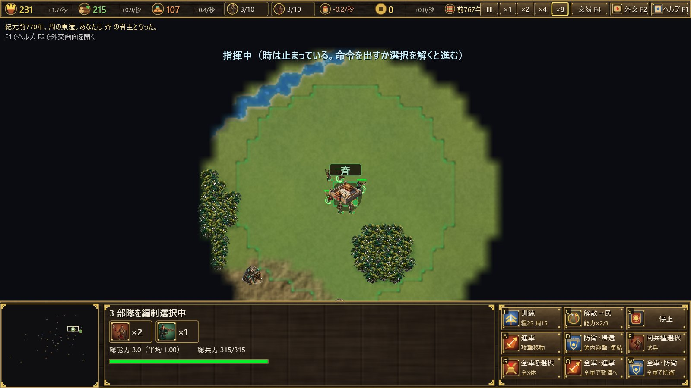

选中己方部队时**时间暂停**，画面上方显示“指揮中”（指挥中）。

- 下达移动、攻击、采集、建造等命令，或取消选择后，时间继续流逝。
- 拖动框选时也会暂停。
- 选中建筑时不会暂停。

## 9. 外交与联盟

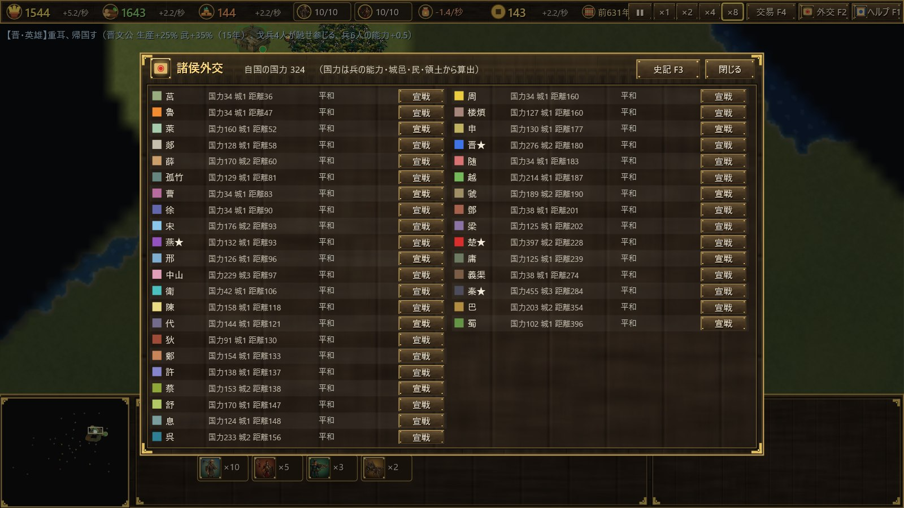

按 **F2** 打开外交画面（諸侯外交）。

- 攻击他国前必须先**宣战（宣戦）**。
- 可以向交战国**提议和谈（和睦）**。对方提出和谈时，点击“受諾”（接受）即可。和谈后会有一段休战期。
- 国家按与己方距离由近到远排列，并显示国力、城邑数与距离。

**霸主号召（春秋）**
反复宣战或攻城会提高“诸侯的警戒”。达到100时，最强之国号召诸侯，周边各国在15年内一齐来攻。

**合纵军（战国）**
出现实力突出的强国时，周边各国合纵，在15年内一齐进攻。

## 10. 时代与史实事件

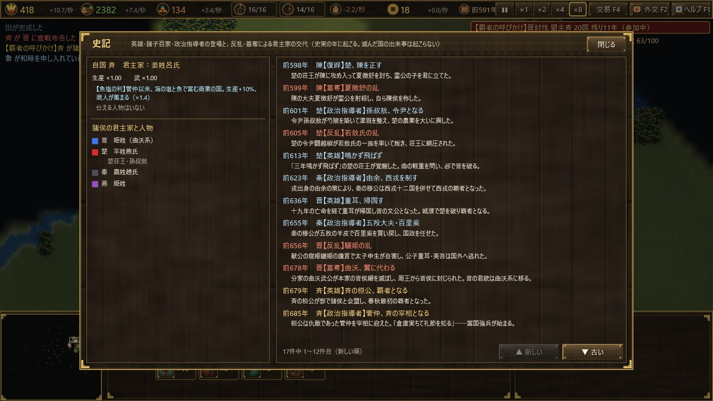

- **春秋时代**（前770〜前453年）：1年＝4秒。
- **战国时代**（前453年起）：1年＝8秒。前453年发生**三家分晋**，晋分为韩、赵、魏。
- **时代加成**对所有国家相同，不会只有个别国家领先。

**史实事件（共83件）**
- 英雄、诸子百家、政治家在史实年份出现（管仲、孔子、孙武、商鞅、白起等），在一定年限内提升该国的生产或武力。
- 叛乱与篡夺会损失兵力和积蓄，并更换君主之家（曲沃代翼、田氏代齐、子之之乱等）。
- 也有合纵、连横、弭兵之会等影响外交的事件。
- 若该国已经灭亡，事件不会发生。

**史记（F3，史記）**中可以查看已发生与未发生事件的记录、各国君主之家与在任人物，以及本国特点。

## 11. 贸易与钱

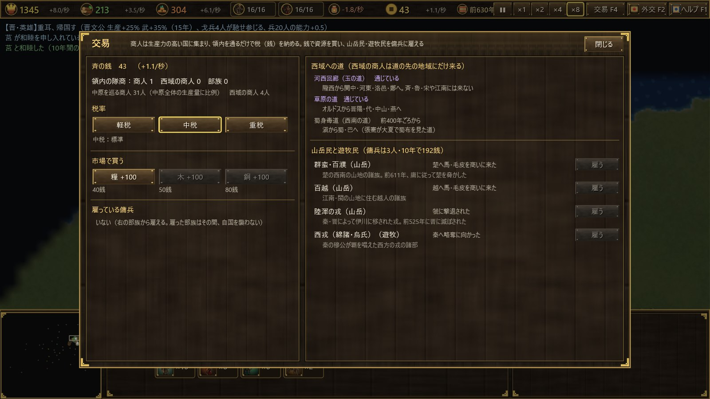

按 **F4**（或点击顶部栏的钱）打开贸易画面（交易）。

**商人与税**
- 不属于任何国家的**商人**周游列国城邑，生产力越高的国家聚集越多。
- 商人**只要经过你的领土，就会缴纳税钱（銭）**。在城邑中交易时缴纳得更多。
- 商人数量与整个中原的总产量成正比增加。
- 处于战争中的国家，商人不太愿意前往。

**税率（税率）**

| 税率 | 税收 | 吸引商人 |
|---|---|---|
| 轻税（軽税） | ×0.6 | ×1.5 |
| 中税（中税） | ×1.0 | ×1.0 |
| 重税（重税） | ×1.5 | ×0.55 |

**市场（市場）**
可用钱购买资源，每次100：粮40、木50、铜80钱（郑国便宜25%）。

## 12. 山民、游牧民与佣兵

山民与游牧民不是国家，只在史实年代出现。

| 部族 | 年代（公元前） | 类型 | 根据地 |
|---|---|---|---|
| 犬戎 | 770〜660 | 游牧 | 陇山以西 |
| 山戎 | 770〜640 | 游牧 | 燕山以北 |
| 群蛮・百濮 | 770〜480 | 山地 | 楚国西南 |
| 百越 | 770〜221 | 山地 | 江南・闽 |
| 陆浑之戎（陸渾の戎） | 638〜525 | 山地 | 伊川 |
| 西戎（绵诸・乌氏） | 660〜330 | 游牧 | 秦国以西 |
| 林胡 | 560〜300 | 游牧 | 鄂尔多斯 |
| 东胡（東胡） | 500〜221 | 游牧 | 燕国东北 |
| 西南夷（滇・夜郎） | 400〜221 | 山地 | 云贵高原 |
| 月氏 | 400〜221 | 游牧 | 河西 |
| 匈奴 | 318〜221 | 游牧 | 阴山以北 |

- 部族每隔几年会到附近的国家来。对防守薄弱的国家，他们会来**劫掠**。攻下城邑后并不占领，而是夺走约三成积蓄和钱后撤回。
- 对防守坚固的国家，他们改为来**贩卖**马匹与毛皮，并像商人一样纳税。
- 在贸易画面点击“**雇う**”（雇佣），可付钱雇佣3名**佣兵**，期限10年。费用为“150＋已过年数×0.3”钱。距己方城邑太远的部族、或正在劫掠己方的部族无法雇佣。
- 佣兵不计入兵数上限与维持费，但不能训练，也不能转为民。
- 雇佣期间，该部族不会劫掠你。

## 13. 西域商人

西域同样不是国家。**西域商人**只到其道路尽头的地区，缴纳的税是普通商人的3倍。

| 道路 | 出现时期 | 到访地区 |
|---|---|---|
| 河西走廊（玉石之路，河西回廊） | 一开始 | 陇西、关中、河东、洛邑、郑 |
| 草原之路（草原の道） | 约前650年起 | 鄂尔多斯、晋阳、代、中山、燕 |
| 蜀身毒道（西南之路） | 约前400年起 | 由滇至蜀、巴 |

西域商人不会到齐、鲁、宋及江南。

## 14. 国家特点

| 国家 | 特点 | 效果 |
|---|---|---|
| 周 | 天子王畿 | 春秋时代不会灭亡（即使最后的城邑被攻破，攻方也会撤兵）。商人×1.3 |
| 晋 | 战车大国（春秋） | 战车攻击＋20%，维持费−10% |
| 秦 | 关中之险 | 城邑与建筑所受伤害−30% |
| 秦 | 军功爵制（前356年起） | 士兵训练费−15% |
| 楚 | 地方五千里 | 生产＋10%，戈兵攻击＋10% |
| 齐 | 鱼盐之利 | 生产＋10%，商人×1.4 |
| 燕 | 北边之守 | 被部族劫掠时损失减半，骑兵攻击＋10% |
| 鲁 | 周礼尽在鲁 | 训练・教化费用−30% |
| 宋 | 殷商之后 | 商人×1.6 |
| 卫 | 小国之智 | 城邑与建筑所受伤害−20% |
| 郑 | 商人之国 | 市场价格−25%，商人×1.2 |
| 吴 | 吴越名剑 | 戈兵攻击＋25% |
| 越 | 卧薪尝胆 | 生产＋10%，维持费−20% |
| 中山 | 千乘之国 | 城邑与建筑所受伤害−25%，骑兵攻击＋10% |
| 巴 | 巴师之勇 | 戈兵攻击＋20% |
| 蜀 | 天府之国 | 生产＋20% |
| 狄・义渠・代・楼烦 | 骑马之民 | 战车・骑兵攻击＋20%，其训练费−20% |
| 韩 | 天下强弓劲弩 | 弩兵攻击＋25% |
| 赵 | 胡服骑射（前307年起） | 骑兵攻击＋20%，其训练费−20% |
| 魏 | 魏武卒 | 戈兵攻击＋20%，生产＋5% |

## 15. 上帝降临（时间到）

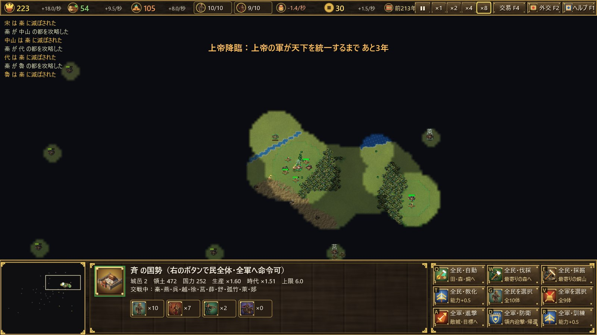

公元前221年过后若天下仍未统一，**上帝便降临于秦**。

- 若秦已灭亡，会在咸阳复活。
- 上帝之军不会受伤，秦也不接受和谈。
- 每年都有城邑归秦，从离秦国都最近的开始，**10年内中华统一**。
- 己方灭亡时，或10年期满时，游戏**强制结束**。即使你是秦国，也不算胜利。

画面上方会显示剩余年数。在英灵模式中，你有办法抵抗上帝之军（见[第16章](#16-英灵模式可选)）。

## 16. 英灵模式（可选）

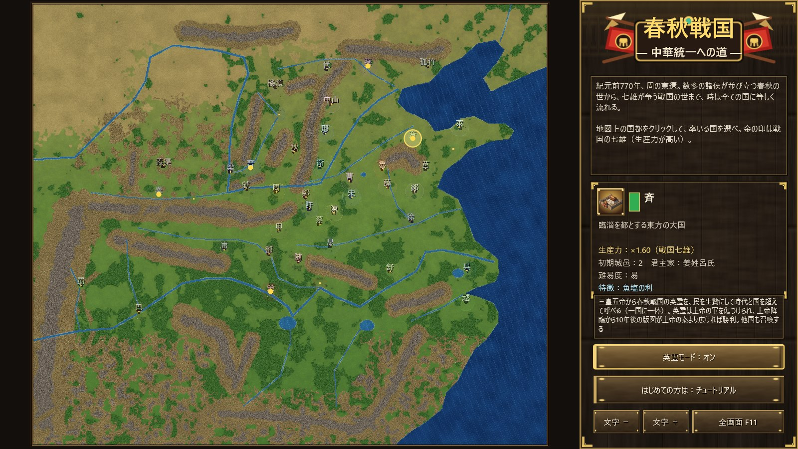

英灵模式**默认关闭**。请在标题画面切换“英霊モード：オフ／オン”（英灵模式：关／开），再选择国家开始。教程中始终关闭。

**召唤方法**
1. 选中位于己方领土内的民（最多10人）。
2. 点击信息栏右下角的“**英霊召喚**”（英灵召唤，H）。
3. 从列表中选择英灵并点击“召喚”（召唤）。所选的民将成为祭品，英灵会在原地出现。

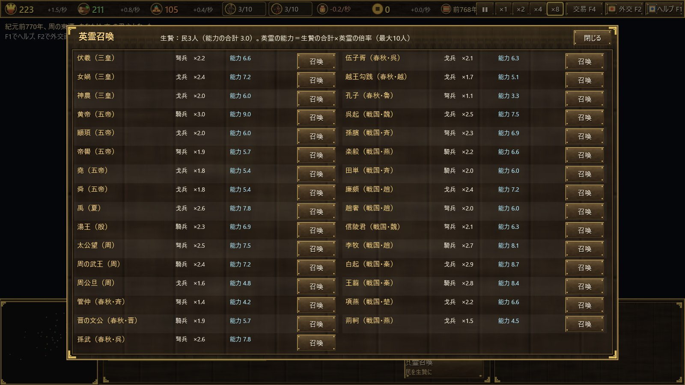

**英灵的规则**
- 从三皇五帝到春秋战国，共31位英灵可以**跨越时代与国家**召唤。秦国也能召唤孙武。
- 英灵的能力为“**作为祭品的民的能力总和 × 各英灵的倍率（1.1〜3.0）**”。例如黄帝×3.0、白起×2.9、孔子×1.1。可以超过时代的能力上限。
- 每位英灵的兵种为戈兵、弩兵或骑兵（战车）之一。
- **一个国家同时只能拥有一位英灵**。英灵倒下后可以再召唤。同一位英灵不会同时出现在两个国家。
- 英灵不计入兵数上限与维持费，并会慢慢恢复伤势。不能训练，也不能转为民。
- **其他国家也会召唤英灵**，在战争中或上帝降临时献祭民来召唤。

**英灵与上帝**
- **只有英灵**能伤害上帝之兵，且其攻击效果为3倍。
- 英灵附近（15格以内）该国的城邑，不在上帝之军每年的预定攻占之列。但仍可能被上帝之兵攻下。
- 上帝降临10年后，**若己方版图（领土）大于上帝之秦，即为胜利**，否则失败。若你是秦国，不算胜利。

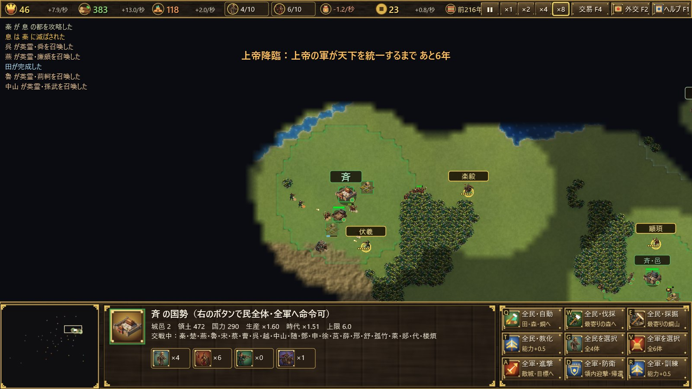

| 英灵 | 时代 | 兵种 | 倍率 |
|---|---|---|---|
| 伏羲・女娲・神农 | 三皇 | 弩・戈・戈 | 2.2・2.4・2.0 |
| 黄帝・颛顼・帝喾・尧・舜 | 五帝 | 骑・戈・弩・戈・戈 | 3.0・2.0・1.9・1.8・1.8 |
| 禹・汤王 | 夏・商 | 戈・骑 | 2.6・2.3 |
| 太公望・周武王・周公旦 | 周 | 弩・骑・戈 | 2.5・2.4・1.6 |
| 管仲・晋文公・孙武・伍子胥・越王勾践・孔子 | 春秋 | 弩・骑・弩・戈・戈・弩 | 1.4・1.9・2.6・2.1・1.7・1.1 |
| 吴起・孙膑・乐毅・田单・廉颇・赵奢・信陵君 | 战国 | 戈・弩・骑・骑・戈・弩・弩 | 2.5・2.3・2.2・2.0・2.4・2.0・2.1 |
| 李牧・白起・王翦・项燕・荆轲 | 战国 | 骑・戈・骑・戈・戈 | 2.7・2.9・2.8・2.2・1.5 |

## 17. 按键一览

| 按键 | 内容 |
|---|---|
| F1／F2／F3／F4 | 帮助／外交／史记／贸易 |
| H | 召唤英灵（英灵模式下选中民时） |
| A | 进军（攻击移动） |
| S | 停止 |
| T | 训练・教化 |
| C | 兵⇔民转换 |
| Q／W／E | 建造・训练（取决于命令栏） |
| Ctrl＋数字／数字 | 编队／调出编队 |
| .（句点） | 选中空闲的民 |
| Home | 回到国都 |
| Space | 暂停 |
| ＋／− | 游戏速度 |
| Esc | 取消・关闭画面 |
| F11 | 全屏 |
| Ctrl＋＋／Ctrl＋− | 文字大小 |

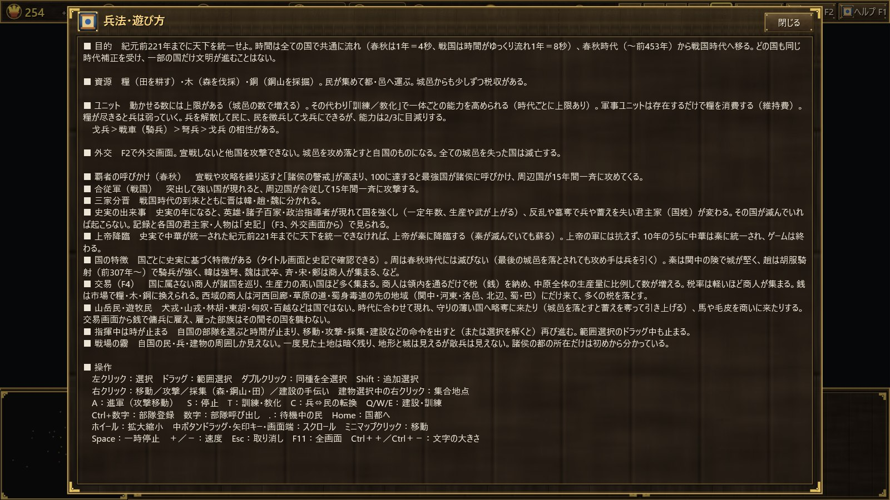

## 18. 攻略提示

- **先增加民**：建田，用民均衡采集粮、木、铜。“全民・自動”很方便。
- **以邑扩张**：民与兵的上限取决于城邑数，多建邑以扩大领土。
- **兵贵精不贵多**：与其增加数量，不如训练提升能力，更省维持费。
- **注意警戒**：频繁开战会招来霸主号召或合纵军，四面受敌。
- **吸引商人**：提高生产力、减轻税率，商人会聚集，钱也随之增加。钱可用来购买短缺资源或雇佣佣兵。
- **防备边境部族**：北方与西方的国家应驻兵防备劫掠，或把部族雇为佣兵。
- **留意时间**：若未在公元前221年前统一，上帝便会降临。进入战国时代后要有计划地扩张。
